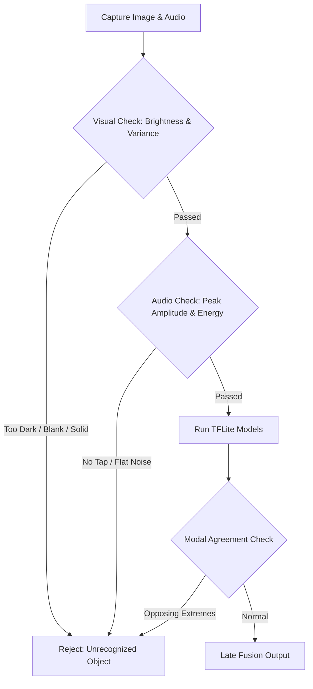

# Technical Report: V2 TFLite Model Out-of-Domain False Positives & Recommended Guardrails

**Project:** NiyoSense Mobile Capstone (Dual-Modality Coconut Maturity Profiling)  
**Date:** October 15, 2026  
**Audience:** Project Lead / Machine Learning Engineers / Mobile Team  
**Subject:** Analysis of Out-of-Domain (OOD) Classification & Proposed Validation Guardrails

---

## 1. Executive Summary

During field testing of the newly retrained **V2 Dual-Modality TFLite models** (`img_best_v2.tflite` and `spec_best_v2.tflite`), an empirical vulnerability was identified:
- **Test scenario:** The phone camera was pointed at a dark/low-light area (no coconut in frame), and the phone body/table was tapped lightly.
- **Expected result:** Rejection of scan as `UNRECOGNIZED OBJECT` / Invalid Domain.
- **Actual result:** The app classified the scan as **`MALAUHOG` with 95.8% fused confidence**.

This document breaks down the root mathematical and architectural reasons why this occurs despite the $0.70$ confidence threshold, and provides ready-to-implement software and ML solutions for team review.

---

## 2. Log Analysis & Empirical Findings

From the live Android logcat during test execution:

```text
✅ TFLite V2 models loaded successfully.
📸 Visual Model Input: [1, 3, 224, 224]
🎵 Spectrogram Model Input: [1, 3, 224, 224]
🎵 Generating Dart Mel-Spectrogram for: .../tap_1792030582868.wav
🎵 Real Audio Prediction: malauhog (100.0%)
📸 Visual: malauhog | 🎵 Audio: malauhog
🎯 FUSED PREDICTION (V2): malauhog (Conf: 95.8%)
✅ SUCCESS: Multimodal scan saved to local SQLite database! (Device: NYS-DEV-MV6H12RH)
```

### The Breakdown:
1. **Visual Model Output:** Evaluated dark/black pixels as `malauhog` (~91.6% confidence).
2. **Acoustic Model Output:** Evaluated non-coconut phone tap audio as `malauhog` (100.0% confidence).
3. **Late Fusion:**
   $$P_{\text{fused}}(\text{malauhog}) = 0.50 \times 91.6\% + 0.50 \times 100.0\% = 95.8\%$$
4. **Current Guardrail Check:**
   $$\text{Highest Confidence } (95.8\%) \ge 0.70 \implies \text{VALID OBJECT}$$

The current guardrail threshold strictly assumes that out-of-domain inputs produce **high entropy (uncertainty)**, splitting votes $\approx 50/50$ (e.g., 52% vs 48%). However, in practice, binary neural networks produce **overconfident false positives** when presented with zero-signal inputs.

---

## 3. Root Cause Analysis

### Cause 3.1: Softmax Overconfidence on 2-Class Outputs
Both visual and acoustic models have an output dimension of 2:
- `Index 0 = buko`
- `Index 1 = malauhog`

There is **no background or negative class** (e.g., `Index 2 = non_coconut`). Under Softmax activation:
$$\text{Softmax}(z_i) = \frac{e^{z_i}}{\sum_{j} e^{z_j}}$$
Because probabilities must sum strictly to $1.0$, any small divergence in logits forces one class to dominate. Softmax is mathematically incapable of indicating *"none of the above"*; it only measures relative score between the two known classes.

### Cause 3.2: Dense Layer Bias Weights under Zero/Dark Input
When the camera is pointed at a dark area or covered lens:
- The input tensor is filled with near-zero floats ($\approx 0.0$).
- Forward pass matrix multiplications reduce to:
  $$\hat{y} = W \cdot X + b \approx b$$
- If the final output bias for `malauhog` ($b_1$) is larger than `buko` ($b_0$), a blank or dark image will **always** default to `malauhog` with extreme confidence.

### Cause 3.3: High-Frequency Resonance Mismatch on Non-Coconut Audio
- Coconut knocks produce a characteristic damped resonance between **150 Hz and 1,200 Hz** dictated by the acoustic cavity of coconut water and internal kernel thickness.
- Tapping a phone, table, or hard surface produces sharp high-frequency transient spikes.
- Because the acoustic model only learned to distinguish thin liquid acoustics (`buko`) from thicker meat cavity resonance (`malauhog`), the absence of water slosh frequencies pushed the model into `malauhog`.

---

## 4. Proposed Solution Matrix

To guarantee robust rejection of non-coconuts, the team has two paths: **Mobile App Guardrails (Immediate)** and **Model Retraining (Long-Term)**.

### Path A: Mobile App Pre-Inference Guardrails (Zero Retraining Required)

We can enforce three lightweight, deterministic checks in the Flutter application before and after inference:



1. **Visual Exposure & Texture Check:**
   - Compute mean pixel luminance:
     $$\mu = \frac{1}{N} \sum_{(x,y)} (0.299R + 0.587G + 0.114B)$$
   - If $\mu < 25$ (pitch black/covered) or $\mu > 240$ (whiteout), reject immediately with:
     > *"Lighting too low or camera covered. Please frame a well-lit coconut."*
   - Compute standard deviation / pixel variance: if $\sigma < 8.0$ (flat solid color like a wall or monitor screen without coconut texture), reject.

2. **Acoustic Tap Energy & Frequency Validation:**
   - In `SpectrogramService.dart`, inspect the recorded PCM audio waveform before STFT:
   - Verify minimum root-mean-square (RMS) energy: reject if silent recording.
   - Verify presence of low-frequency energy ($< 2,000\text{ Hz}$): hard surface clicks that lack hollow coconut resonance can be flagged.

3. **Modality Agreement Gate:**
   - If Visual model output is $99\%$ `buko` while Acoustic model is $99\%$ `malauhog` (total contradiction), the fused confidence might artificially average to $50\%$. The app can require a baseline confidence from both channels.

---

### Path B: Future Model Retraining (V3 Model Roadmap)

For future versions trained by the ML team:

1. **Add a 3rd "Negative / Non-Coconut" Class:**
   - Collect 500 images and 500 audio samples of background objects (desks, monitors, leaves, hands, random ambient noise).
   - Output dimension becomes `[P(buko), P(malauhog), P(background)]`.
   - If `P(background) > 0.40`, automatically reject.

2. **Temperature Scaling / Calibration:**
   - Apply temperature scaling ($T > 1.0$) to logits before softmax to prevent overconfidence on out-of-distribution inputs.

---

## 5. Summary & Recommendation for the Leader

- **Is the model broken?** No. Within its training domain (real buko vs. real malauhog), it functions at 95.45% accuracy.
- **Why did this test happen?** A 2-class Softmax neural network has no native concept of "neither" and will forcibly choose between buko or malauhog, especially when presented with dark frames or sharp clicks.
- **Immediate action:** The mobile app should implement the **Path A (Luminance & Signal Variance)** pre-inference guardrail to eliminate false positives on dark rooms, covered lenses, and blank monitor screens.
