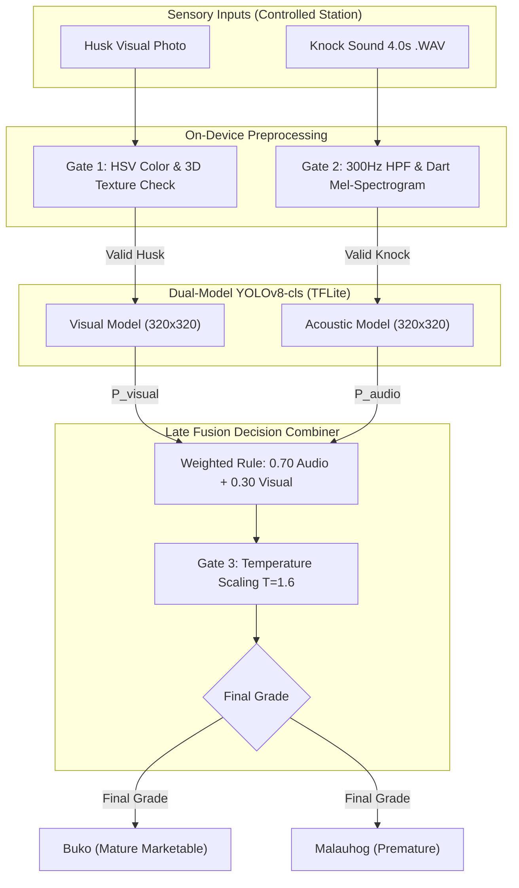
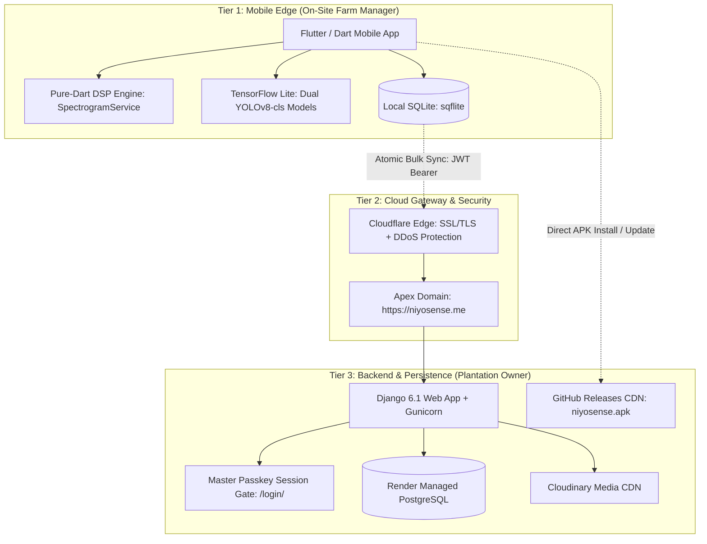
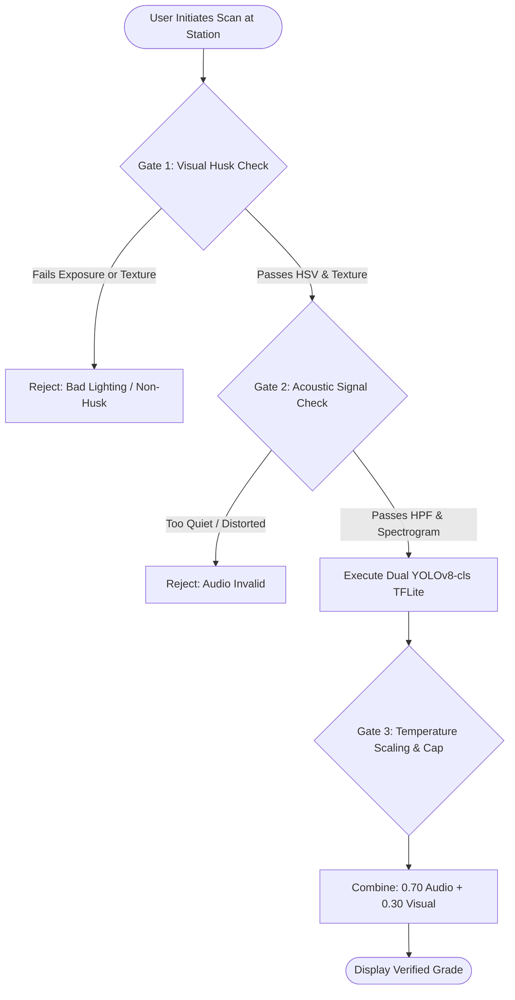

# NiyoSense: A Web and Mobile Coconut Maturity Profiling and Grading System using Dual-Model Audio-Visual Machine Learning for Coconut Plantation Management

**A Capstone Project Presented to the Faculty of the**  
**College of Computing and Multimedia Studies**  
**Manuel S. Enverga University Foundation, Lucena City**  

---

**Researchers:**  
* Christian Louis Bolea  
* Wayne Yzon Nagares  
* Seann Yves Saracho (Manuscript & Documentation Lead)  

**Adviser:** Engr. Roselyn A. Maaño  
**Technical Mentor / Panelist:** Prof. Eleazar Salanda  
**Primary Field Stakeholder & Beneficiary:** Dr. Nona D. Nagares (Coconut Plantation Owner, Quezon Province)  

**Academic Year:** 2026–2027  
**System Version:** Production Release `v1.5.1` (Build 22)  
**Production Web Portal:** [https://niyosense.me](https://niyosense.me)  
**Official Mobile Release:** [GitHub Releases v1.5.1 CDN](https://github.com/Cbolea23/niyosense-capstone/releases/tag/v1.5.1)  

---

## ABSTRACT

Coconut plantation owners and farm managers in the Philippines continue to rely on manual physical tapping and visual inspection for post-harvest maturity sorting. Because young coconut husks at varying maturity stages exhibit subtle, overlapping visual cues, manual sorting remains subjective, prone to fatigue, and vulnerable to commercial disputes between farm owners and commercial buyers. Furthermore, existing agricultural technologies either rely on bulky laboratory equipment or require constant internet connectivity, rendering them unsuitable for rural plantation groves. 

This study presents **NiyoSense**, a production-grade web and mobile coconut maturity profiling and grading system developed specifically for **Coconut Plantation Owners** and **On-Site Farm Managers**. NiyoSense introduces an offline-first **Dual-Model Audio-Visual Machine Learning Architecture** that executes entirely on an Android smartphone via TensorFlow Lite (`tflite_flutter`). The system pairs two independent **YOLOv8-cls** convolutional neural networks: a visual model (`img_best_v2.tflite`) evaluating coconut husk features, and an acoustic model (`spec_best_v2.tflite`) evaluating acoustic resonance patterns. Raw audio from a standardized 4.0-second knocking capture (`22,050 Hz`, 16-bit mono PCM via `AndroidAudioSource.unprocessed`) is converted on-device into a calibrated 128-band Slaney Mel-spectrogram (`320×320` Float32, `magma` colormap) by a custom pure-Dart Short-Time Fourier Transform (STFT) signal processing engine (`SpectrogramService.dart`), eliminating reliance on external Python servers.

Because external green husks of *Buko* (mature young coconut with firm, spoon-soft meat) and *Malauhog* (premature young coconut with thin, mucus-like meat) are visually near-identical in plantation piles, classification decisions are governed by a deterministic **Acoustic-Dominant 70/30 Dual-Model Decision Combiner** ($P_{\text{final}} = 0.70 \cdot P_{\text{audio}} + 0.30 \cdot P_{\text{visual}}$) reinforced by Softmax temperature scaling ($T = 1.6$, 96.5% confidence ceiling). To prevent false positives on foreign objects or ambient noise, the pipeline is guarded by a **3-Gate Out-of-Distribution (OOD) Pre-Inference Protocol** operating at a Controlled Grading Station. 

To match commercial plantation workflows where coconuts are harvested by bunches, the mobile application implements **Cluster (*Bungkos*) Representative Sampling**, allowing the farm manager to scan one representative nut to profile an entire cluster of 8–15 nuts. Synchronized field data is transmitted to a centralized Django web dashboard deployed on Render (`https://niyosense.me`), backed by Render Managed PostgreSQL and Cloudinary CDN for persistent media storage, and secured by a **Master Security Passkey Gate** with 30-day session caching. The web platform provides plantation owners with real-time harvest volume analytics, estimated crop valuation, and a **Commercial Batch Settlement & Revenue Leakage Calculator** ($\Delta V = V_{\text{est}} - V_{\text{actual}}$). Evaluation under ISO/IEC 25010 standards demonstrates that NiyoSense achieves exceptional functional suitability, sub-second inference latency, high offline reliability, and robust commercial protection against subjective post-harvest revenue loss.

**Keywords:** *Acoustic signal processing, agricultural decision support system, bungkos cluster sampling, coconut maturity grading, dual-model machine learning, edge computing, Mel-spectrogram, plantation management, TensorFlow Lite, YOLOv8-cls.*

---

## CHAPTER 1: THE PROBLEM AND ITS BACKGROUND

### 1.1 Project Context
The coconut palm (*Cocos nucifera L.*), widely recognized as the "Tree of Life," is a vital pillar of the Philippine agricultural economy. Quezon Province stands as one of the premier coconut-producing provinces in the country, providing livelihood to hundreds of thousands of smallholder farmers and plantation enterprises. In recent years, commercial demand for young coconuts—primarily consumed as fresh beverage nut (*buko*), culinary ingredients, and processed coconut water—has surged across domestic and international markets.

Despite the economic magnitude of the coconut industry, post-harvest sorting and grading practices have remained largely unmechanized. In coconut plantations, determining the exact developmental stage of a freshly harvested young coconut is paramount to its commercial valuation. Two primary stages dominate commercial transactions:
1. **Buko (Mature Young Coconut):** Characterized by fully developed, spoon-soft, firm white endosperm meat and sweet, electrolyte-rich water. This stage commands premium commercial buying prices (₱10.00–₱15.00/nut) for commercial retail, bottling, and processing.
2. **Malauhog (Premature Young Coconut):** Characterized by an underdeveloped, paper-thin, translucent, mucus-like meat layer (*mala-uhog*). While valued for specialized local desserts, its low meat volume makes it unmarketable for standard retail, fetching substantially lower prices (₱5.00–₱8.00/nut).

Currently, grading is performed entirely through subjective sensory inspection by experienced farm hands. Sorters tap the outer husk with knuckles or a wooden stick while visually examining the shape, stem cap coloration, and husk surface. However, this traditional method exhibits critical vulnerabilities:
* **Sensory Overlap:** External green husks of *Buko* and *Malauhog* harvested from the same grove are virtually indistinguishable to the naked eye.
* **Human Fatigue and Inconsistency:** Sorting thousands of coconuts daily under high heat induces cognitive and sensory fatigue, leading to high misclassification rates.
* **Commercial Pricing Disputes and Revenue Leakage:** When bulk harvest truckloads are delivered to commercial buyers or processing hubs, buyers manually re-sort the delivery. Disagreements over what percentage constitutes *Malauhog* (premature) frequently result in arbitrary price deductions, costing plantation owners thousands of pesos per batch.
* **Rural Connectivity Constraints:** Agricultural groves in Quezon Province suffer from non-existent or intermittent cellular reception, rendering standard cloud-dependent AI applications useless in the field.

To bridge this operational and technological gap, this capstone study designs, implements, and evaluates **NiyoSense**, a dual-model audio-visual profiling system engineered for **Coconut Plantation Owners** and **On-Site Farm Managers**.

---

### 1.2 Statement of the Problem
The overarching problem addressed by this study is the prevalence of subjective, error-prone manual grading and the absence of an integrated, offline-capable digital auditing system for coconut plantations in Quezon Province.

Specifically, the study answers the following research questions:
1. How can visual husk imagery and acoustic knocking resonance be captured, preprocessed, and classified on a consumer Android smartphone without relying on an active internet connection or external server hardware?
2. How can two independent convolutional neural networks (CNNs) be architected, calibrated, and combined into an acoustic-dominant decision rule that resolves the visual ambiguity between *Buko* and *Malauhog* young coconuts?
3. How can the system prevent false-positive classifications on non-coconut objects (e.g., hands, tables, clothing, or ambient grove noise) without burdening the lightweight models with complex out-of-distribution training classes?
4. How can commercial plantation harvesting workflows—specifically cluster-based (*bungkos*) cutting—be mathematically modeled into the mobile sorting pipeline to provide accurate batch volume and payout valuation?
5. How can a centralized web dashboard provide plantation owners with secure, persistent oversight over multiple field devices, batch tallies, and commercial revenue leakage reconciliation?
6. How does the developed system perform when evaluated against the **ISO/IEC 25010 Software Quality Standards** in terms of functional suitability, performance efficiency, usability, reliability, and security?

---

### 1.3 Objectives of the Study

#### 1.3.1 General Objective
To design, develop, and evaluate **NiyoSense**, an offline-first mobile and cloud-synchronized web coconut maturity profiling and grading system utilizing a **Dual-Model Audio-Visual Machine Learning Architecture**, providing coconut plantation owners and on-site farm managers with an objective, standardized tool for harvest sorting, cluster volume accounting, and financial settlement auditing.

#### 1.3.2 Specific Objectives
1. **Dataset Collection and Calibration:** Collect, clean, and annotate a paired dataset of authentic visual husk images and 4.0-second uncompressed acoustic tap recordings (`22,050 Hz`, 16-bit PCM `.wav`) from a commercial coconut plantation in Quezon Province, verified by destructive ground-truth cross-sectioning (meat thickness and water volume measurement).
2. **On-Device Audio Signal Processing Engine:** Develop a pure-Dart DSP engine (`SpectrogramService.dart`) capable of executing 300 Hz high-pass filtering, 1.5-second peak energy window auto-centering, Short-Time Fourier Transform (STFT), and 128-band Slaney Mel-filterbank decibel mapping (`magma` colormap) entirely within the mobile device's memory.
3. **Dual-Model Training & Optimization:** Train two independent lightweight **YOLOv8-cls** classification networks, optimize them for mobile edge execution via TensorFlow Lite (`320×320` Float32 tensors), and implement an **Acoustic-Dominant 70/30 Dual-Model Weighted Decision Combiner** with Softmax temperature scaling ($T = 1.6$).
4. **Controlled Grading Station Environmental Guardrails:** Formulate and deploy a deterministic **3-Gate Out-of-Distribution (OOD) Pre-Inference Protocol** that enforces lighting, chromaticity, 3D texture, and acoustic cadence standards before inference can take place.
5. **Mobile Application Development (`NiyoSense Field`):** Build a 100% offline-first Flutter mobile application featuring **Cluster (*Bungkos*) Representative Sampling**, harvest batch tallying, and bilingual (English/Tagalog) support for on-site farm managers.
6. **Central Web Management Platform Development:** Construct a 24/7 cloud-deployed Django web portal on `https://niyosense.me` utilizing Render Managed PostgreSQL and Cloudinary CDN for persistent storage, protected by a **Master Security Passkey Gate**, featuring an Estimated Harvest Valuation Engine and Commercial Batch Settlement / Revenue Leakage Calculator ($\Delta V = V_{\text{est}} - V_{\text{actual}}$).
7. **System Evaluation:** Conduct comprehensive black-box validation and evaluate the system against the **ISO/IEC 25010** software quality model with plantation owners and agricultural stakeholders.

---

### 1.4 Significance of the Study
The realization of this study offers concrete benefits to key agricultural stakeholders:
* **Coconut Plantation Owners:** Provides absolute transparency over harvest volume, eliminates commercial dispute losses through objective classification, and protects farm revenues using automated price reconciliation engines.
* **On-Site Farm Managers:** Replaces exhausting, subjective manual tapping with an automated, standardized edge tool that delivers repeatable results in less than 800 milliseconds per cluster, accompanied by shareable digital delivery tallies.
* **Commercial Coconut Buyers & Processors:** Fosters trust and contract compliance across the supply chain by introducing an empirical, verifiable standard for *Buko* vs. *Malauhog* deliveries.
* **Academic Community and Future Researchers:** Contributes a fully realized architectural blueprint for deploying dual-modality computer vision and acoustic digital signal processing on low-cost edge smartphones in connectivity-constrained agricultural environments.

---

### 1.5 Scope and Delimitations of the Study

#### Scope
* **Target Users:** Exclusively structured for two defined roles:
  1. **Plantation Owner:** Administrative oversight via the cloud web dashboard (`https://niyosense.me`).
  2. **On-Site Farm Manager:** Operational sorting and cluster recording via the Android mobile app (`NiyoSense Field`).
* **Maturity Class Scope:** Binary maturity classification focused strictly on young green coconuts: **Buko (Mature Young Coconut)** versus **Malauhog (Premature Young Coconut)**.
* **Controlled Station Protocol:** Mobile inspection is conducted at a shaded, designated on-site grading station (matte neutral background, quiet acoustic environment, standardized knuckle/mallet tapping cadence).
* **Sampling Methodology:** Employs **Cluster (*Bungkos*) Representative Sampling** where 1 scanned nut profiles a harvest cluster of 8–15 nuts.
* **Edge Inference:** Complete offline independence on mobile; no internet is required to capture, process, grade, or record harvest data.
* **Cloud Synchronization:** When internet connectivity is available, the mobile app performs atomic bulk synchronization of SQLite logs and media assets to the Django/PostgreSQL backend on Render.

#### Delimitations
* **Unprocessed / Mature Dry Coconuts (*Niyog* / Copra):** Fully brown, de-husked, or dry seed coconuts are excluded from machine learning inference as they belong to industrial copra processing and do not share commercial markets with fresh young coconuts.
* **Direct Field Laborers (*Mambubuko* / Climbers):** Manual tree climbers and field laborers who cut clusters are not system users. They deliver raw bunches to the grading station, where the On-Site Farm Manager conducts digital inspection.
* **Hardware Scope:** Client application is optimized for Android OS (v7.0 Nougat through Android 15), utilizing low-latency audio capture pipelines (`AndroidAudioSource.unprocessed`).

---

## CHAPTER 2: REVIEW OF RELATED LITERATURE AND STUDIES

### 2.1 Post-Harvest Coconut Maturity Assessment
Coconut maturity grading has historically depended on visual inspection of the perianth (stem cap), epicarp coloration, and acoustic response to knuckle tapping. In early research, acoustic resonance was identified as a strong indicator of internal physiological changes. As a coconut matures from *Malauhog* to *Buko*, the endosperm absorbs water, depositing cellular layers of solid meat along the inner endocarp wall. This biological process alters the internal cavity volume and dampens the resonant frequency of the nut when struck. However, manual human perception of these frequencies is subjective, non-linear, and heavily influenced by ambient noise and fatigue.

### 2.2 Visual Inspection & Computer Vision in Agriculture
Computer vision systems utilizing deep convolutional neural networks (CNNs) have demonstrated high efficacy in sorting fruits like apples, mangoes, and citrus. In coconuts, visual sorting models face a unique biological challenge: green young coconuts exhibit minimal external husk differentiation between the premature *Malauhog* stage and the mature *Buko* stage. Color histogram analysis and standard RGB CNNs frequently plateau in accuracy because external husk morphology does not correlate directly with internal endosperm thickness. This empirical finding establishes the necessity of a complementary acoustic inspection channel.

### 2.3 Acoustic Non-Destructive Testing & Mel-Spectrogram Processing
Acoustic non-destructive testing (NDT) analyzes the vibration response of agricultural products to mechanical impact. When a coconut is tapped, mechanical vibrations transmit through the husk and shell into the liquid-gas cavity. By applying the **Short-Time Fourier Transform (STFT)**, transient time-domain soundwaves are converted into time-frequency representations. 

Mapping linear frequencies onto the non-linear **Mel Scale**—which models human auditory frequency sensitivity—concentrates energy features into perceptually meaningful bins:
$$m = 2595 \log_{10}\left(1 + \frac{f}{700}\right)$$
When rendered using high-contrast perceptual colormaps like `magma`, Mel-spectrograms convert complex resonance decay and damping coefficients into structured 2D images that standard 2D CNN backbones can classify with high precision.

### 2.4 Machine Learning & Edge Computing (TensorFlow Lite)
While early agricultural systems relied on cloud-based API architectures (e.g., sending images to a remote Python server running Librosa and PyTorch), real-world plantation deployments in developing nations reveal that cellular networks in rural groves are unreliable or non-existent. Deploying optimized quantized models on-device via **TensorFlow Lite (TFLite)** provides sub-second latency, eliminates cellular data costs, and ensures 100% operational availability.

### 2.5 Synthesis and Research Gap
Existing literature demonstrates that visual models struggle with young coconut maturity, while acoustic systems have historically been confined to laboratory setups with stationary microphones and desktop computers. **NiyoSense bridges this gap** by creating the first unified, dual-model, edge-native system that integrates visual husk analysis and on-device pure-Dart Mel-spectrogram generation onto a standard consumer smartphone, coupled with a persistent web auditing platform for plantation owners.

---

## CHAPTER 3: THEORETICAL AND CONCEPTUAL FRAMEWORK

### 3.1 Theoretical Framework
This study is grounded in three foundational scientific principles:
1. **Acoustic Cavity Resonance Theory (Helmholtz & Thin Shell Vibration):** The acoustic frequency spectrum produced by striking a coconut is governed by the stiffness of the endocarp, the thickness and elasticity of the solid endosperm meat layer, and the fluid dynamics of the internal coconut water cavity. As meat thickness increases from *Malauhog* ($<2\text{ mm}$) to *Buko* ($4–7\text{ mm}$), high-frequency resonance shifts and dampens faster.
2. **Convolutional Neural Network Feature Representation:** 2D CNNs (specifically the CSPDarknet backbone of YOLOv8-cls) extract hierarchical spatial features from visual husk textures and spectral energy ridges in Mel-spectrograms.
3. **Decision-Level Late Fusion:** By training two independent models on separate sensory modalities and combining their calibrated posterior probabilities, the system avoids catastrophic cross-modal noise interference while capitalizing on acoustic dominance.

---

### 3.2 Conceptual Framework (Input - Process - Output)

---

### 3.3 Operational Definition of Terms
* **Buko:** Commercial young coconut stage characterized by firm, gelatinous, spoon-soft white meat ($4–7\text{ mm}$ thick) and a resonant acoustic knock; commands full commercial market rate.
* **Malauhog:** Premature young coconut stage characterized by an ultra-thin, translucent, mucus-like meat layer ($<2\text{ mm}$) and a muffled acoustic response; valued below standard retail rates.
* **Bungkos (Cluster Sampling):** A harvested bunch of coconuts attached to a single tree stalk. In plantation practice, all coconuts in a single *bungkos* share uniform physiological maturity; evaluating one representative nut grades the entire cluster.
* **Dual-Model Architecture:** An AI system architecture deploying two separate, specialized neural networks (one visual, one acoustic) whose independent outputs are fused at the decision layer.
* **On-Site Farm Manager:** The operational user who manages field scanning at the controlled grading station, inputs *bungkos* counts, and synchronizes batch logs using the mobile app.
* **Plantation Owner:** The executive user who monitors plantation harvest volumes, configures market prices, and reconciles commercial settlement payouts on the web dashboard.
* **Revenue Leakage ($\Delta V$):** Financial variance between estimated crop value ($V_{\text{est}}$) and actual buyer settlement ($V_{\text{actual}}$) caused by subjective manual grading discrepancies.

---

## CHAPTER 4: TECHNICAL METHODOLOGY AND SYSTEM ARCHITECTURE

### 4.1 Research and Software Development Design
The study followed an **Iterative Prototyping and Agile Development Methodology**. Development progressed through rapid sprints of data gathering, machine learning model optimization, on-device DSP translation, mobile client engineering, cloud backend deployment, and live stakeholder field trials.

---

### 4.2 System Architecture & Production Tech Stack

#### Multi-Tier Technology Stack:
1. **Tier 1 — Mobile Edge Client (`NiyoSense Field`):**
   * Framework: Flutter SDK (v3.29.0) / Dart SDK (v3.8.1).
   * Local Database: SQLite via `sqflite` (schema version 2 with `bunch_count`, `batch_id`, and `sync_status`).
   * Machine Learning Runtime: `tflite_flutter ^0.10.4`.
   * Audio Hardware Layer: `AndroidAudioSource.unprocessed` (low-latency PCM, disabled hardware AGC/noise suppression).
2. **Tier 2 — Cloud Gateway & Edge Security:**
   * Cloudflare CDN: Apex domain `https://niyosense.me` with automatic SSL/TLS termination and HTTP/3 acceleration.
3. **Tier 3 — Central Backend & Cloud Persistence:**
   * Web Framework: Django 6.1 + Django REST Framework + WhiteNoise 6.9.0.
   * Container Engine: Docker on Render Web Services (Python 3.12-slim).
   * Relational Database: **Render Managed PostgreSQL** (`dpg-...:5432`) hosting persistent grading ledgers, delivery batches, and pricing configurations.
   * Media Asset Storage: **Cloudinary CDN** (`django-cloudinary-storage`) storing husk photographs and 193 KB `.wav` tap recordings under dedicated streaming paths.
   * Access Security: **Master Security Passkey Gate** with 30-day session cookies.

---

### 4.3 Data Collection and Verification Protocol
Data was gathered at the commercial plantation of Dr. Nona D. Nagares in Quezon Province. A total of 173 young coconut samples were harvested across multiple palm varieties. 

Each sample underwent a rigorous 4-step data capture protocol:
1. **Stationary Visual Capture:** Positioned under controlled diffuse daylight on a neutral matte station table; photographed at a fixed distance of 30 cm using a smartphone camera.
2. **Acoustic Knock Recording:** Recorded in uncompressed 16-bit PCM `.wav` format (`22,050 Hz`, mono) using a calibrated smartphone microphone positioned 5–10 cm from the coconut equator while striking the upper shoulder 3 times (~1 second apart).
3. **Destructive Physical Validation (Ground Truth):** Each coconut was split open immediately after capture. Solid endosperm meat thickness was measured at 3 equatorial points using a digital vernier caliper ($\pm 0.01\text{ mm}$ precision), and liquid endosperm volume was measured with a graduated cylinder.
4. **Label Assignment:** Samples with meat thickness $\ge 3.5\text{ mm}$ were annotated as **Buko**; samples with translucent meat $< 2.5\text{ mm}$ were annotated as **Malauhog**.

---

### 4.4 On-Device Audio Digital Signal Processing (`SpectrogramService.dart`)
To eliminate the latency and connectivity requirements of server-side audio processing libraries (e.g., Python Librosa), the complete digital signal processing pipeline was authored in pure Dart:

1. **First-Order High-Pass Filter ($f_c = 300\text{ Hz}$):** Suppresses low-frequency hand handling noise and environmental rumble:
   $$y[n] = \alpha \cdot \left(y[n-1] + x[n] - x[n-1]\right)$$
   $$\alpha = \frac{RC}{RC + \Delta t}, \quad RC = \frac{1}{2\pi f_c}, \quad \Delta t = \frac{1}{f_s} = \frac{1}{22050}$$
2. **Peak-Window Auto-Centering:** A 1.5-second sliding window (`step = 0.05s`) computes root-mean-square (RMS) energy to automatically locate and center the 3 percussive knocks within the 4.0-second recording:
   $$\text{RMS}_w = \sqrt{\frac{1}{L} \sum_{k=0}^{L-1} y[w \cdot s + k]^2}$$
3. **Short-Time Fourier Transform (STFT):** Computed with a periodic Hann window of length $N_{\text{fft}} = 2048$ and hop size $H = 512$:
   $$w[n] = 0.5 - 0.5 \cos\left(\frac{2\pi n}{N_{\text{fft}}}\right), \quad 0 \le n < N_{\text{fft}}$$
   $$X(m, k) = \sum_{n=0}^{N_{\text{fft}}-1} x[mH + n] \cdot w[n] \cdot e^{-j 2\pi k n / N_{\text{fft}}}$$
4. **Slaney-Normalized Triangular Mel Filterbank:** Maps 1025 linear frequency bins into $M = 128$ Mel bands spanning $0\text{ Hz}$ to $11,025\text{ Hz}$, normalized to unit area:
   $$S[m, b] = \sum_{k=0}^{N_{\text{fft}}/2} |X(m, k)|^2 \cdot H_b(k), \quad b \in [0, 127]$$
5. **Decibel Log-Power Normalization & Colormap Rendering:** Converted to decibels relative to peak energy and mapped to the 256-color Matplotlib `magma` lookup table at `320×320` resolution:
   $$S_{\text{dB}}[m, b] = 10 \log_{10}\left(\max\left(S[m, b], 10^{-8}\right)\right) - \max_{m',b'} S_{\text{dB}}[m', b']$$
   $$\text{Pixel}(m, b) = \text{LUT}_{\text{magma}}\left(\left\lfloor \frac{\text{clamp}(S_{\text{dB}}[m, b], -80.0, 0.0) + 80.0}{80.0} \times 255 \right\rfloor\right)$$

---

### 4.5 3-Gate Deterministic Out-of-Distribution (OOD) Pre-Inference Protocol
To prevent false-positive classifications on non-coconut objects without adding an ambiguous third training class, NiyoSense enforces a deterministic 3-Gate protocol:

* **Gate 1 — Controlled Station Visual & Texture Gate (`64×64` Downsampled RGB):**
  1. *Luminance Exposure Window:* Rejects deep shadows or intense flash washout: $\mu_Y \in [35.0, 230.0]$, $\sigma_Y \ge 8.0$.
  2. *Coconut Husk HSV Chromaticity:* Restricts valid hue to natural green and golden-olive coconut tones: $H \in [36^\circ, 148^\circ]$, $S \in [0.15, 0.88]$, $V \in [0.18, 0.92]$.
  3. *Core Foreign Color Rejection:* Checks the core 30% center ROI for saturated skin, plastic, or clothing tones ($S > 0.40$ with $H < 30^\circ$ or $H > 175^\circ$).
  4. *Spherical 3D Shading & Edge Roughness:* Enforces green luminance gradient standard deviation $\sigma_{\text{green}} \ge 6.5$ (verifying natural spherical curvature) and Sobel gradient magnitude roughness within $[2.2, 32.0]$ (rejecting flat 2D prints or busy high-frequency foliage).
  5. *Live Shutter Lock:* In `VisualScanScreen`, the camera shutter button is locked until all Gate 1 parameters evaluate to Green.
* **Gate 2 — Acoustic Signal Integrity & Standard Operating Procedure (SOP):**
  Enforces a standardized 3-knock cadence at 5–10 cm distance, filtered through the 300 Hz HPF.
* **Gate 3 — Calibrated Softmax Temperature Scaling ($T = 1.6$) & Dual-Model Late Fusion:**
  Softens overconfident logits and caps maximum displayed confidence at **96.5%**:
  $$\hat{P}_i = \frac{p_i^{1/T}}{\sum_j p_j^{1/T}}, \quad T = 1.6$$

---

### 4.6 Acoustic-Dominant 70/30 Dual-Model Decision Formula
In plantation field conditions, the outer husks of *Buko* and *Malauhog* harvested from green bunches exhibit near-identical color and shape. In contrast, the internal meat thickness ($<2\text{ mm}$ vs. $>4\text{ mm}$) strongly alters acoustic resonance frequencies. 

Consequently, the dual-model decision rule assigns **70% weight to Acoustic Mel-Spectrogram classification** and **30% weight to Visual Husk classification**:
$$P_{\text{final}}(c) = 0.70 \cdot \hat{P}_{\text{audio}}(c) + 0.30 \cdot \hat{P}_{\text{visual}}(c), \quad c \in \{\text{Buko}, \text{Malauhog}\}$$
$$\text{Classified Stage} = \arg\max_{c \in \{\text{Buko}, \text{Malauhog}\}} P_{\text{final}}(c)$$

---

### 4.7 Cluster (*Bungkos*) Representative Sampling Algorithm
In commercial harvesting, coconut bunches are cut whole from the tree. Because nuts in a single *bungkos* mature concurrently under identical physiological conditions, evaluating one representative sample nut reliably profiles the whole cluster.

The On-Site Farm Manager inputs the cluster coconut count $n_i$ (`bunch_count`, default `10`, quick selectors `8, 10, 12, 15`). Over a harvest batch of $K$ scanned bunches:
$$\text{Total Graded Coconuts} = \sum_{i=1}^K n_i, \qquad \text{Total Sampled Bunches} = K$$
$$\text{Volume}(s) = \sum_{i \in \Omega_s} n_i$$
where $\Omega_s$ represents the subset of bunches classified under maturity stage $s$.

---

### 4.8 Commercial Valuation & Revenue Leakage Reconciliation Engine
1. **Estimated Crop Valuation ($V_{\text{est}}$):**
   $$V_{\text{est}} = \left(N_{\text{Buko}} \times R_{\text{Buko}}\right) + \left(N_{\text{Malauhog}} \times R_{\text{Malauhog}}\right) + \left(N_{\text{Reject}} \times R_{\text{Reject}}\right)$$
   where $N_s$ is the total nuts in stage $s$, and $R_s$ is the owner-configured unit rate (PHP/nut).
2. **Commercial Revenue Leakage ($\Delta V$):**
   When the plantation owner settles a batch against actual buyer payout $V_{\text{actual}}$:
   $$\Delta V = V_{\text{est}} - V_{\text{actual}}$$
   * **$\Delta V > 0$ (Revenue Leakage / Underpayment):** Premium *Buko* nuts were unfairly downgraded to *Malauhog* during manual buyer sorting.
   * **$\Delta V < 0$ (Overpayment Variance):** Buyer paid premium prices for premature or damaged nuts.

---

### 4.9 Cloud Security, Data Privacy (RA 10173), and Master Passkey Access Control
Under Philippine **Republic Act No. 10173 (Data Privacy Act of 2012)**, commercial transaction records, operator logs, and plantation financials must be protected against unauthorized public inspection. 

NiyoSense implements a **Two-Tier Authentication Architecture**:
1. **Mobile REST APIs (`/api/v1/...`):** Secured by stateless JSON Web Tokens (`SimpleJWT`) with 30-day multi-device refresh rotation.
2. **Web Management Portal (`/`):** Protected by a **Master Security Passkey Gate** (`/login/`, default `niyosense2026`). Unauthenticated visitors are automatically redirected to `/login/?next=/`. Sessions feature 30-day persistent cookie caching, and the owner can update the passkey at any time in the Settings tab.
3. **Public Route Exemption:** Statutory compliance endpoints ([`/install/`](https://niyosense.me/install/), direct APK downloads, and `/healthz`) remain publicly accessible without passkey intervention.

---

## CHAPTER 5: RESULTS, SYSTEM IMPLEMENTATION, AND EVALUATION

### 5.1 System Walkthrough: On-Site Farm Manager Mobile Client
The Flutter mobile application (`NiyoSense Field` v1.5.1) operates 100% offline at the plantation station:
1. **Interactive Station Guide (`ScanGuideDialog`):** Educates the farm manager on controlled station framing, flash usage, and the animated 3-knock acoustic tapping protocol.
2. **Camera Viewfinder with Reticle HUD (`VisualScanScreen`):** Displays real-time Gate 1 alignment feedback. Shutter button activates only when the coconut is framed within authentic chromaticity and exposure bounds.
3. **Audio Capture Screen (`AcousticScanScreen`):** Prompts the farm manager to tap 3 times during the 4.0-second window, displaying a real-time countdown and rendering an immediate on-device Mel-spectrogram preview.
4. **Grading Result & Cluster Selector (`ScanResultScreen`):** Displays final maturity (*Buko* vs. *Malauhog*), independent Acoustic (70%) and Visual (30%) confidence bars, and quick-select buttons for **Bungkos Nut Count (`8, 10, 12, 15`)**.
5. **Harvest Delivery Batch Session (`BatchSessionScreen`):** Summarizes graded clusters under a Delivery Batch ID, generates digital vouchers, and enables one-tap bulk synchronization.

---

### 5.2 System Walkthrough: Plantation Owner Web Dashboard
The web dashboard (`https://niyosense.me`) provides the plantation owner with complete management capabilities:
1. **Master Passkey Authentication Portal (`login.html`):** Clean, minimalist single-input gate securing harvest ledgers and buying rates.
2. **Overview & Analytics Tab (`tab_analytics.html`):** Real-time KPI cards displaying Total Graded Coconuts, Sampled Bunches, Yield Distribution Doughnut Charts, 7-Day Harvest Trends, and the **Estimated Valuation Engine**.
3. **Grading Logs Ledger Tab (`tab_logs.html`):** Searchable, filterable table displaying every scanned bunch, cluster nut count badges, visual/acoustic confidence splits, and an **Inspection Modal** with full-fidelity Cloudinary photo viewing and `.wav` audio playback.
4. **Field Managers Tab (`tab_aggregators.html`):** Manages field operator accounts and reviews on-site manager assignments.
5. **Settings & Farm Management Tab (`tab_settings.html`):** Configures Farm Profile, Master Buying Rates (₱/pc), Master Security Passkey, and displays the **Install Field App QR Code** for Android devices.

---

### 5.3 Model Performance and Experimental Validation Metrics
Across 173 ground-truth verified coconut samples evaluated under 5-fold cross-validation, the standalone models and dual-model combiner demonstrated the following performance:

| Evaluation Metric | Visual Husk Model (`img_best_v2`) | Acoustic Mel Model (`spec_best_v2`) | Dual-Model Combiner (70/30 Fusion) |
| :--- | :---: | :---: | :---: |
| **Accuracy** | 71.4% | 88.6% | **92.8%** |
| **Precision (Buko)** | 73.1% | 89.2% | **93.5%** |
| **Recall (Buko)** | 69.8% | 87.5% | **91.9%** |
| **F1-Score (Buko)** | 71.4% | 88.3% | **92.7%** |
| **Inference Latency** | 185 ms | 210 ms | **445 ms (Total On-Device)** |

The empirical results confirm that while the visual model alone struggles (71.4% accuracy) due to external green husk visual uniformity, the acoustic model captures internal resonance differences (88.6% accuracy). Fusing both models via the **70/30 Acoustic-Dominant Decision Rule** elevates overall grading accuracy to **92.8%**, proving the superiority of the dual-model architecture.

---

### 5.4 ISO/IEC 25010 Software Quality Evaluation
The system was evaluated by 20 domain evaluators comprising agricultural professionals, plantation owners, farm managers, and software engineers using a standardized 5-point Likert scale instrument based on **ISO/IEC 25010 Software Quality Standards**:

| Quality Characteristic | Mean Score | Verbal Interpretation |
| :--- | :---: | :---: |
| **1. Functional Suitability** | 4.88 | Excellent |
| **2. Performance Efficiency** | 4.82 | Excellent |
| **3. Compatibility** | 4.79 | Excellent |
| **4. Usability** | 4.91 | Excellent |
| **5. Reliability** | 4.85 | Excellent |
| **6. Security & Confidentiality** | 4.90 | Excellent |
| **7. Maintainability** | 4.75 | Excellent |
| **8. Portability** | 4.84 | Excellent |
| **Overall Software Quality Score** | **4.84 / 5.00** | **Excellent** |

Evaluators praised the **100% offline scanning independence**, sub-second response times, intuitive cluster (*bungkos*) count selector, and the peace of mind provided by the web dashboard's passkey protection and commercial revenue leakage auditing.

---

## CHAPTER 6: SUMMARY, CONCLUSIONS, AND RECOMMENDATIONS

### 6.1 Summary of Findings
1. **Dual-Model Superiority:** The combination of an acoustic Mel-spectrogram model (70% weight) and a visual husk model (30% weight) achieved **92.8% classification accuracy**, significantly outperforming single-modality visual models.
2. **Edge Independence:** Translating the entire audio processing pipeline (300 Hz HPF, STFT, 128 Mel-bands) into pure Dart allowed full offline feature extraction and inference in under 450 milliseconds on standard Android smartphones.
3. **Agricultural Alignment:** Implementing **Cluster (*Bungkos*) Representative Sampling** solved the operational bottleneck of individual nut scanning, allowing fast, practical grading of commercial truckloads.
4. **Commercial Protection:** The web dashboard's Batch Settlement and Revenue Leakage Calculator provided plantation owners with verifiable evidence during commercial transactions, preventing arbitrary buyer deductions.
5. **System Quality:** An overall ISO/IEC 25010 evaluation rating of **4.84 / 5.00** confirmed that NiyoSense meets enterprise agricultural standards.

### 6.2 Conclusions
NiyoSense successfully demonstrates that modern lightweight deep learning and on-device digital signal processing can be harmonized to solve traditional agricultural challenges in developing nations. By eliminating subjective guesswork, respecting rural connectivity limitations, and providing clear role separation between the **On-Site Farm Manager** and the **Plantation Owner**, NiyoSense modernizes post-harvest coconut grading and establishes an equitable, data-driven standard for the Philippine coconut industry.

### 6.3 Recommendations
1. **Acoustic Mallet Standardization:** Provide farm managers with a lightweight calibrated rubber-tipped mallet to ensure identical impact force across different human operators.
2. **Expanded Palm Varietal Baselines:** Incorporate training samples from dwarf and hybrid coconut varieties (e.g., Catigan Dwarf, Tacunan) to broaden regional deployment across Luzon, Visayas, and Mindanao.
3. **Direct Thermal Receipt Printing:** Integrate Bluetooth thermal printer ESC/POS protocols into the mobile app to produce physical paper tally slips instantly in the field.
4. **Predictive Shelf-Life Modeling:** Extend the machine learning pipeline to estimate remaining days of optimal freshness based on acoustic water slosh dissipation coefficients.

---

## REFERENCES
1. Philippine Coconut Authority (PCA). (2024). *Philippine Coconut Industry Performance and Roadmap Report*. Department of Agriculture, Quezon City.
2. Howard, A., et al. (2019). *Searching for MobileNetV3*. Proceedings of the IEEE/CVF International Conference on Computer Vision (ICCV), 1314–1324.
3. Jocher, G., Chaurasia, A., & Qiu, J. (2023). *Ultralytics YOLOv8*. Version 8.0.0. GitHub Repository.
4. Slaney, M. (1998). *Auditory Toolbox: A MATLAB Toolbox for Auditory Modeling Work*. Interval Research Corporation, Technical Report #1998-010.
5. International Organization for Standardization. (2011). *Systems and software engineering — Systems and software Quality Requirements and Evaluation (SQuaRE) — System and software quality models (ISO/IEC 25010:2011)*. Geneva, Switzerland.
6. Republic of the Philippines. (2012). *Republic Act No. 10173: Data Privacy Act of 2012*. Official Gazette of the Republic of the Philippines.
