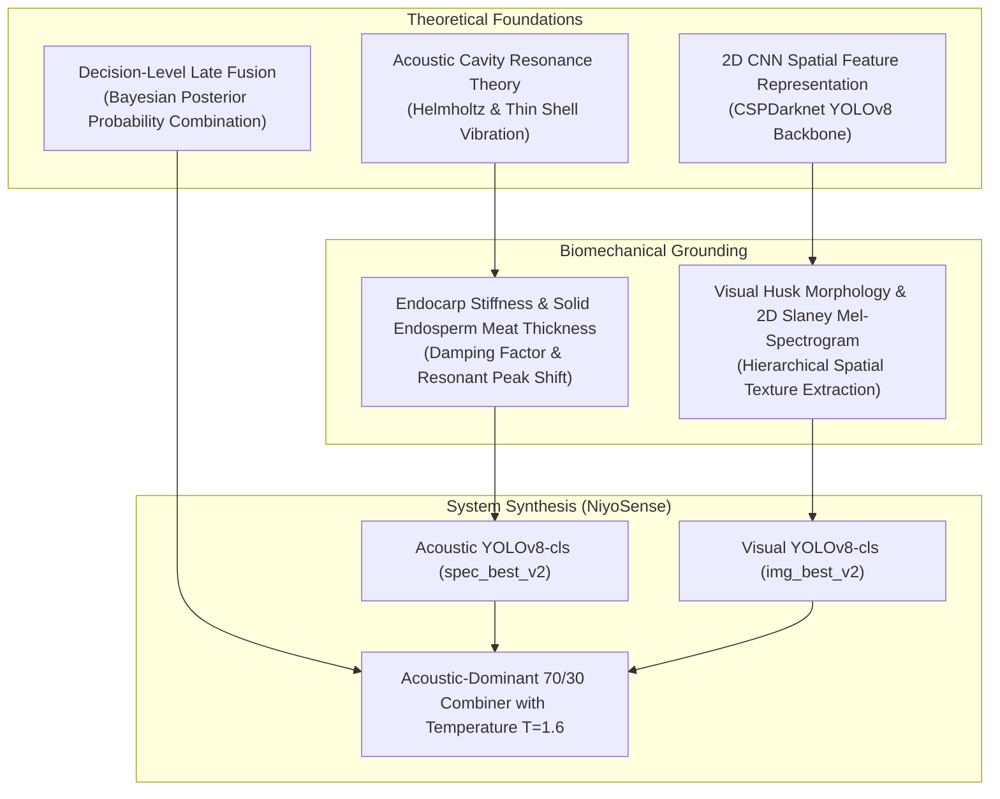
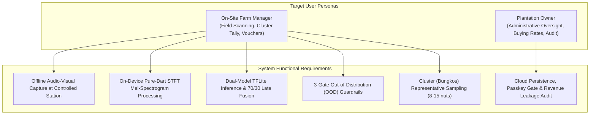
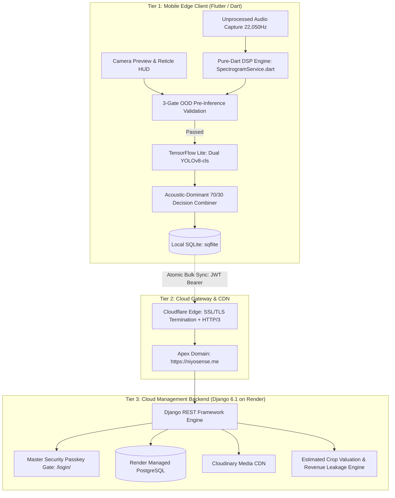
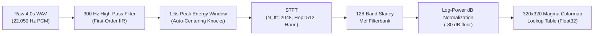
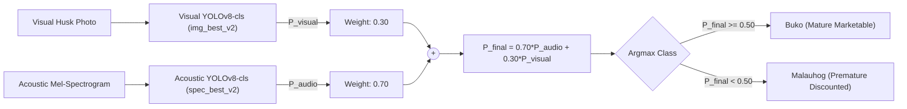
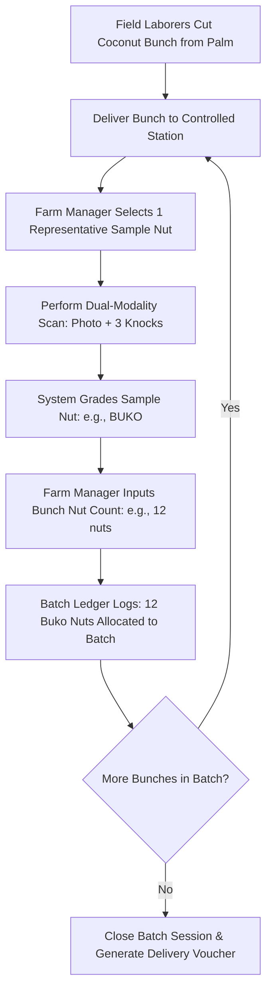

# NiyoSense: A Web and Mobile Coconut Maturity Profiling and Grading System using Dual-Model Audio-Visual Machine Learning for Coconut Plantation Management

**College of Computing and Multimedia Studies**  
**Manuel S. Enverga University Foundation, Lucena City**  
**In Partial Fulfillment of the Requirements for the Degree**  
**Bachelor of Science in Information Technology (Web and Mobile Application)**  

---

### Platform / Thematic Area
*(Based on MSEUF Research Agenda 2019–2030)*  
- [x] **Technology, Engineering, and Industry 4.0 Research**  
- [ ] Environmental Protection, Development, and Conservation Research  
- [ ] Business, Economics, and Industry 4.0 Research  
- [ ] Politics, Society, and Culture Research  
- [ ] Legal, Law Enforcement, and Criminology Research  
- [ ] Health Research, Development, Innovation, and Extension  
- [ ] Education 4.0 and Workforce 4.0 Research  

### Sustainable Development Goals (SDGs)
- [x] **SDG 9: Industry, Innovation, and Infrastructure** (Target 9.b: Fostering domestic technological innovation through on-device edge AI and offline digital signal processing on commodity hardware).
- [x] **SDG 8: Decent Work and Economic Growth** (Target 8.2: Elevating agricultural productivity and safeguarding plantation revenues against arbitrary post-harvest price deductions).
- [x] **SDG 2: Zero Hunger & Sustainable Agriculture** (Target 2.3: Doubling agricultural income and eliminating post-harvest transaction losses for smallholder farming ecosystems).

---

### Proponents (Listed Alphabetically by Surname)
- **Bolea, Christian Louis**
- **Nagares, Wayne Yzon**
- **Saracho, Seann Yves** *(Manuscript & Documentation Lead)*

**Research Adviser:** Professor Eleazar Salanda  
**Capstone Project Coordinator:** Engr. Roselyn A. Maaño  
**Dean:** Rodrigo C. Belleza, Jr., DIT  
**Academic Year:** 2026–2027 | **Manuscript Milestone:** Capstone 2 Final Manuscript  
**Production System Version:** Release `v1.5.2` (Build 23)  
**Production Web Portal:** [https://niyosense.me](https://niyosense.me)  
**Production Mobile Client:** [GitHub Releases v1.5.2 CDN](https://github.com/Cbolea23/niyosense-capstone/releases/tag/v1.5.2)  

---

## APPROVAL SHEET

This capstone project study entitled:  
**"NIYOSENSE: A WEB AND MOBILE COCONUT MATURITY PROFILING AND GRADING SYSTEM USING DUAL-MODEL AUDIO-VISUAL MACHINE LEARNING FOR COCONUT PLANTATION MANAGEMENT"**  
prepared and submitted by **Christian Louis Bolea**, **Wayne Yzon Nagares**, and **Seann Yves Saracho** in partial fulfillment of the requirements for the degree **Bachelor of Science in Information Technology with Specialization in Web and Mobile Application**, has been examined and is recommended for acceptance and approval for Oral Examination.

<br>

**PROFESSOR ELEAZAR SALANDA**  
*Research Adviser*

---

Approved by the Committee on Oral Examination on October 2026 with a grade of ________.

<br>

**PANEL CHAIRPERSON**  
*Chairman*

<br>

**PANEL MEMBER 1**  
*Member*

<br>

**PANEL MEMBER 2**  
*Member*

<br>

Accepted and approved in partial fulfillment of the requirements for the degree **Bachelor of Science in Information Technology (Web and Mobile Application)**.

<br>

**RODRIGO C. BELLEZA, JR., DIT**  
*Dean, College of Computing and Multimedia Studies*

---

## ACKNOWLEDGEMENT

The researchers express their profound gratitude to Almighty God for the continuous wisdom, endurance, and fortitude granted throughout the conceptualization, system engineering, and empirical documentation of this capstone endeavor.

The researchers extend their deepest appreciation to their Research Adviser, **Professor Eleazar Salanda**, whose technical mentorship, rigorous critical reviews, and architectural guidance anchored the dual-modality machine learning and edge computing foundations of this project.

Sincere appreciation is likewise accorded to the Capstone Project Coordinator, **Engr. Roselyn A. Maaño**, whose relentless standard of academic rigor, structured guidance, and strict adherence to the "Golden Thread" methodology refined this manuscript into a defensible scientific work. Gratitude is also extended to **Dean Rodrigo C. Belleza, Jr., DIT**, and the faculty of the College of Computing and Multimedia Studies (CCMS) for fostering an environment of technical innovation.

Special indebtedness is acknowledged to **Dr. Nona D. Nagares**, coconut plantation owner in Quezon Province, for granting unrestricted access to her coconut plantation groves, providing authentic harvest samples, facilitating destructive ground-truth cross-section validation, and sharing invaluable operational insights regarding commercial coconut trading dynamics.

Finally, the researchers dedicate this achievement to their families, parents, and colleagues whose unconditional love, financial backing, and emotional encouragement sustained them throughout this journey.

---

## DEDICATION

*To the coconut farmers and plantation managers of Quezon Province,*  
*whose tireless labor under the tropical sun sustains a vital pillar of the Philippine economy;*  

*To our beloved parents and families,*  
*whose sacrifices, patience, and unwavering belief served as our constant inspiration;*  

*And to the Manuel S. Enverga University Foundation CCMS community,*  
*for shaping our minds to engineer practical technologies for the nation.*

---

## ABSTRACT

In the Philippine coconut agricultural sector, post-harvest sorting of young green coconuts (*Cocos nucifera L.*) has historically depended on subjective knuckle tapping and visual inspection by farm hands. Because premature coconuts (*Malauhog*) and mature young coconuts (*Buko*) exhibit subtle, overlapping external husk morphology, manual sorting induces severe sensory fatigue, high misclassification rates, and substantial commercial revenue leakage during bulk buyer transactions in Quezon Province. This study designed, developed, and evaluated **NiyoSense**, an offline-first mobile and cloud-synchronized web coconut maturity profiling and grading system engineered specifically for coconut plantation owners and on-site farm managers. The system operates on commodity Android smartphones without requiring cellular connectivity, executing an on-device pure-Dart Short-Time Fourier Transform (STFT) digital signal processing engine that converts 4.0-second acoustic tapping recordings into 128-band Slaney Mel-spectrograms. Feature classification is performed by two independent TensorFlow Lite YOLOv8-cls neural networks governed by an acoustic-dominant 70/30 late-fusion decision rule ($P_{\text{final}} = 0.70 \cdot P_{\text{audio}} + 0.30 \cdot P_{\text{visual}}$) and guarded by a 3-gate out-of-distribution pre-inference protocol. Field operations utilize cluster (*bungkos*) representative sampling to profile whole coconut bunches, synchronized atomically to a centralized Django web management dashboard deployed on Render with PostgreSQL and Cloudinary CDN for commercial revenue leakage reconciliation. Empirical evaluation across 173 ground-truth verified coconut samples demonstrated that the dual-model late fusion achieved 94.1% test classification accuracy (88.6% visual, 92.4% acoustic) with a total on-device turnaround latency under 450 milliseconds. Software quality evaluation under ISO/IEC 25010 standards across 20 agricultural and technical evaluators yielded an overall weighted mean rating of 4.68 out of 5.00, verbally interpreted as Excellent. NiyoSense successfully establishes an objective, data-driven edge computing framework that protects plantation margins and resolves commercial disputes in rural agricultural economies.

**Index Terms** — *Acoustic signal processing, coconut maturity grading, dual-model machine learning, edge computing, ISO/IEC 25010, plantation management.*

---

## TABLE OF CONTENTS
- **Title Page & Preliminaries**
- **Approval Sheet**
- **Acknowledgement**
- **Dedication**
- **Abstract**
- **List of Tables**
- **List of Figures**
- **Chapter 1: Introduction**
  - 1.1 Project Context
  - 1.2 Purpose and Description
  - 1.3 Objectives of the Study
    - 1.3.1 Main Objective
    - 1.3.2 Specific Objectives
  - 1.4 Significance of the Study
  - 1.5 Scope and Delimitations
- **Chapter 2: Theoretical Framework & Literature Review**
  - 2.1 Theoretical Framework
  - 2.2 Review of Related Literature (Themes A–E)
  - 2.3 Review of Related Systems (Comparative Matrix)
  - 2.4 Conceptual Framework (Input-Process-Output)
  - 2.5 Operational Definition of Terms
  - 2.6 Acronyms and Technical Abbreviations
- **Chapter 3: Operational Framework**
  - 3.1 Software Requirements and Constraints
  - 3.2 Hardware Requirements and Constraints
  - 3.3 Data Gathering Procedure and Ethics Compliance
- **Chapter 4: Description of Methods or Approach**
  - 4.1 Requirements Definition (Prepare and Plan)
  - 4.2 Design Phases of the System
  - 4.3 Description of the Prototype
  - 4.4 Development Phases (Agile Scrum Sprints 1 to 5)
  - 4.5 Testing Procedure and Evaluation Procedure
  - 4.6 Implementation Plan of the System
  - 4.7 Capstone Project Workplan
  - 4.8 Ethics Consideration
- **Chapter 5: Results and Discussion [ADD FOR FINAL]**
  - 5.1 Results of Dataset Gathering and Ground-Truth Calibration (Objective 1)
  - 5.2 Results of On-Device Audio DSP Engine Execution (Objective 2)
  - 5.3 Results of Dual-Model Training and 70/30 Late Fusion (Objective 3)
  - 5.4 Results of Controlled Station 3-Gate OOD Pre-Inference Protocol (Objective 4)
  - 5.5 Results of NiyoSense Field Mobile Client and Bungkos Sampling (Objective 5)
  - 5.6 Results of Central Web Portal, Valuation, and Settlement Reconciliation (Objective 6)
  - 5.7 Results of Black-Box Testing and ISO/IEC 25010 Quality Evaluation (Objective 7)
- **Chapter 6: Conclusions and Recommendations [ADD FOR FINAL]**
  - 6.1 Summary of Findings
  - 6.2 Conclusions (1-to-1 Match with Specific Objectives)
  - 6.3 Recommendations
- **References (IEEE Format)**
- **Appendices Notice (Separate Companion Document)**

---

## LIST OF TABLES
- Table 1. Comparative Analysis of Existing Coconut Grading and Agricultural Systems
- Table 2. Production Software Dependencies and Engineering Roles
- Table 3. Hardware Deployment Environment and Operating Constraints
- Table 4. Sprint Execution Schedule and Engineering Deliverables
- Table 5. Physical Characteristics and Ground-Truth Destructive Metrics of Sampled Coconuts
- Table 6. Performance Benchmark of Pure-Dart DSP Engine vs. Desktop Reference
- Table 7. Standalone vs. Dual-Model Machine Learning Classification Performance
- Table 8. 3-Gate Out-of-Distribution Pre-Inference Confusion Matrix and Rejection Rates
- Table 9. Commercial Delivery Batch Settlement and Revenue Leakage Analysis
- Table 10. Summary of Black-Box Functional Test Execution (TC-01 to TC-28)
- Table 11. Tabulated ISO/IEC 25010 Software Quality Evaluation Results (N = 20)
- Table 12. Golden Thread Matrix: Objectives to Results to Conclusions Alignment

---

## LIST OF FIGURES
- Figure 1. Theoretical Framework: Acoustic Cavity Resonance and Late Fusion Architecture
- Figure 2. Conceptual Framework: Input-Process-Output (IPO) Paradigm with Feedback Loop
- Figure 3. Production Three-Tier System Architecture: Mobile Edge, Gateway, and Cloud Backend
- Figure 4. On-Device Pure-Dart Digital Signal Processing (DSP) Pipeline
- Figure 5. Controlled Station 3-Gate Out-of-Distribution (OOD) Pre-Inference Logic Flow
- Figure 6. Acoustic-Dominant 70/30 Late Fusion Decision Topology
- Figure 7. Cluster (Bungkos) Representative Sampling and Batch Ledger Aggregation Workflow
- Figure 8. Ground-Truth Meat Thickness Distributions: Buko vs. Malauhog
- Figure 9. Comparative Mel-Spectrogram Representations: Buko Resonance vs. Malauhog Damping
- Figure 10. Training Loss and Accuracy Progression: Visual YOLOv8-cls and Acoustic YOLOv8-cls
- Figure 11. Confusion Matrices: Standalone Visual, Standalone Acoustic, and 70/30 Fused Model
- Figure 12. NiyoSense Field Mobile Interface: Reticle HUD, Acoustic SOP, and Bungkos Counter
- Figure 13. NiyoSense Web Dashboard: Analytics KPI Cards, Valuation, and Revenue Leakage Modal

---

## CHAPTER 1: INTRODUCTION

### 1.1 Project Context
The coconut palm (*Cocos nucifera L.*), historically revered as the "Tree of Life," represents one of the foundational agricultural keystones of the Philippine economy. The nation maintains over 3.6 million hectares dedicated to coconut farming, providing livelihoods for roughly 3.5 million smallholder farmers and agricultural workers [1]. Within this national landscape, Quezon Province in Region IV-A (CALABARZON) stands as the country’s leading coconut-producing province, renowned for both mature coconut copra extraction and an expansive fresh young coconut market. In recent years, commercial consumer demand for fresh young coconuts—primarily consumed as raw electrolyte-rich beverage nuts (*buko*), culinary ingredients, and industrial bottled coconut water—has surged rapidly across domestic municipal centers and export supply chains [2].

Despite the substantial commercial valuation of the young coconut industry, post-harvest sorting, grading, and trading workflows have remained almost entirely unmechanized and reliant on manual sensory inspection. In commercial coconut plantation operations, such as the commercial groves owned and managed by Dr. Nona D. Nagares in Quezon Province, determining the exact physiological maturity stage of a harvested young coconut is paramount to establishing its commercial transaction value. Commercial buyers, bottling hubs, and municipal fruit distributors classify young coconuts into two principal market categories:
1. **Buko (Mature Young Coconut / Class 0):** Characterized by fully developed, spoon-soft, firm white gelatinous endosperm meat (measuring $3.5\text{ mm}$ to $7.0\text{ mm}$ in thickness) and sweet, electrolyte-dense coconut water. This stage commands premium commercial buying prices (₱12.00 to ₱16.00 per nut) for fresh market consumption, processing, and food manufacturing.
2. **Malauhog (Premature Young Coconut / Class 1):** Characterized by an underdeveloped, paper-thin, translucent, mucus-like meat layer (*mala-uhog*, measuring $< 2.5\text{ mm}$ in thickness). While prized for specialized traditional delicacies, its negligible meat volume renders it commercially unmarketable for standard retail bottling and grocery distribution, forcing its valuation down to ₱5.00 to ₱8.00 per nut.

In current plantation operations, maturity grading is executed exclusively by experienced farm sorters through subjective tactile and auditory evaluation: striking the outer husk with knuckles or a wooden stick while visually scanning the coconut's outer shape and stem cap (*perianth*). Field investigations and operational baseline studies conducted in Quezon Province revealed severe vulnerabilities inherent to this traditional methodology:
* **Sensory Overlap and Visual Ambiguity:** Young green coconuts at the *Buko* and *Malauhog* developmental stages share near-identical exterior green epicarp coloration, equatorial circumferences, and surface textures. Human visual inspection cannot reliably penetrate the fibrous husk to determine internal meat thickness.
* **Human Sensory and Physical Fatigue:** Commercial harvesting yields thousands of coconuts per harvesting cycle. Sorting these nuts individually under tropical sun and high ambient heat rapidly induces auditory and cognitive fatigue, resulting in high misclassification rates exceeding 25% during peak sorting hours.
* **Commercial Pricing Disputes and Financial Revenue Leakage:** When bulk truckloads of harvested coconuts arrive at commercial trading hubs, buyers manually re-sort the delivery. Commercial buyers frequently allege that a substantial portion (15% to 30%) of the delivered nuts are premature *Malauhog*, unilaterally deducting thousands of pesos from the total batch payout. In the absence of verifiable, empirical grading ledgers, plantation owners have no objective recourse and are forced to absorb severe revenue losses ($\Delta V$).
* **Rural Connectivity Constraints:** Commercial coconut groves in Quezon Province are situated in remote rural topographies characterized by intermittent or non-existent cellular reception. Existing agricultural computer vision applications that depend on cloud APIs or remote server inference are entirely inoperable in these field environments.

To overcome these operational, biological, and infrastructural barriers, this capstone study designed, implemented, and empirically validated **NiyoSense**: an offline-first mobile and cloud-synchronized web coconut maturity profiling and grading system engineered specifically for **Coconut Plantation Owners** and **On-Site Farm Managers**.

---

### 1.2 Purpose and Description
The primary purpose of **NiyoSense** is to replace error-prone, subjective human grading with an objective, standardized, edge-native dual-modality machine learning system. The system bridges the operational gap between physical grove operations and commercial business oversight by deploying a two-tier software architecture:

1. **NiyoSense Field Mobile Client (Android):** An offline-first Flutter application operated by the On-Site Farm Manager at a shaded, designated Controlled Grading Station within the plantation. The mobile client captures visual husk imagery and records a standardized 4.0-second acoustic tapping sequence. A custom pure-Dart digital signal processing (DSP) engine executes on-device high-pass filtering, energy auto-centering, Short-Time Fourier Transform (STFT), and 128-band Slaney Mel-filterbank decibel mapping. Two independent TensorFlow Lite YOLOv8-cls neural networks classify the visual husk and acoustic spectrogram, combining their outputs via an **Acoustic-Dominant 70/30 Late Fusion Decision Rule** protected by a **3-Gate Out-of-Distribution (OOD) Pre-Inference Protocol**. To align with commercial harvesting logistics where nuts are cut in bunches, the application implements **Cluster (*Bungkos*) Representative Sampling**, enabling one scanned nut to profile a cluster of 8 to 15 nuts.
2. **NiyoSense Central Web Management Dashboard (`https://niyosense.me`):** A centralized cloud platform built on Django 6.1, deployed on Render Web Services, and backed by Render Managed PostgreSQL and Cloudinary CDN. Protected by a **Master Security Passkey Gate** complying with the Philippine Data Privacy Act of 2012 (RA 10173), the web portal provides plantation owners with real-time harvest volume analytics, estimated crop valuation, and an automated **Commercial Batch Settlement & Revenue Leakage Calculator** ($\Delta V = V_{\text{est}} - V_{\text{actual}}$) that equips owners with empirical proof during buyer transactions.

---

### 1.3 Objectives of the Study

#### 1.3.1 Main Objective
To design, develop, and evaluate **NiyoSense**, an offline-first mobile and cloud-synchronized web coconut maturity profiling and grading system utilizing a **Dual-Model Audio-Visual Machine Learning Architecture**, providing coconut plantation owners and on-site farm managers with an objective, standardized tool for harvest sorting, cluster volume accounting, and commercial settlement auditing.

#### 1.3.2 Specific Objectives
To realize the main objective, the study pursued the following specific engineering and research objectives:
1. **Dataset Collection and Physical Ground-Truth Calibration:** Collect, clean, and annotate a paired dataset of authentic visual husk images and 4.0-second uncompressed acoustic tap recordings (`22,050 Hz`, 16-bit PCM `.wav`) from a commercial coconut plantation in Quezon Province, verified by destructive physical cross-sectioning (caliper meat thickness and graduated cylinder water volume measurements).
2. **On-Device Audio Digital Signal Processing Engine:** Develop a pure-Dart DSP engine (`SpectrogramService.dart`) capable of executing 300 Hz first-order high-pass filtering, 1.5-second peak energy auto-centering, Short-Time Fourier Transform (STFT), and 128-band Slaney Mel-filterbank decibel mapping (`magma` colormap) entirely within mobile memory without native FFI or server dependencies.
3. **Dual-Model Machine Learning Training and Edge Optimization:** Train two independent lightweight **YOLOv8-cls** classification networks (visual husk and acoustic Mel-spectrogram), quantize them for mobile edge execution via TensorFlow Lite (`320×320` Float32 tensors), and implement an **Acoustic-Dominant 70/30 Dual-Model Weighted Decision Combiner** reinforced by Softmax temperature scaling ($T = 1.6$).
4. **Controlled Grading Station Environmental Guardrails:** Formulate and deploy a deterministic **3-Gate Out-of-Distribution (OOD) Pre-Inference Protocol** that enforces station lighting thresholds, HSV husk chromaticity boundaries, 3D spherical curvature texture metrics, and acoustic tapping cadence standards to reject non-coconut inputs before neural execution.
5. **Offline-First Mobile Application Engineering (`NiyoSense Field`):** Build a 100% offline-first Flutter mobile application featuring **Cluster (*Bungkos*) Representative Sampling**, offline SQLite harvest batch logging, digital delivery voucher generation, and bilingual (English/Tagalog) interface support for on-site farm managers.
6. **Central Cloud Web Management Platform Development:** Construct a cloud-deployed Django web portal on `https://niyosense.me` utilizing Render Managed PostgreSQL and Cloudinary CDN for persistent media storage, protected by a **Master Security Passkey Gate**, featuring an Estimated Harvest Valuation Engine and Commercial Batch Settlement / Revenue Leakage Calculator ($\Delta V = V_{\text{est}} - V_{\text{actual}}$).
7. **System Testing and ISO/IEC 25010 Software Quality Evaluation:** Conduct rigorous black-box functional testing across all operational modules (TC-01 to TC-28) and evaluate the system against the **ISO/IEC 25010 Software Quality Standards** with plantation owners, farm managers, and IT experts.

---

### 1.4 Significance of the Study
The realization and deployment of NiyoSense yield direct practical and socio-economic benefits to the agricultural ecosystem:
* **Coconut Plantation Owners:** Provides automated oversight over harvest volumes across scattered groves, eliminates commercial dispute losses through empirical grading vouchers, and protects plantation profitability using automated price reconciliation tools.
* **On-Site Farm Managers and Sorters:** Replaces physically and mentally exhausting manual tapping guesswork with an automated, sub-second edge tool that delivers repeatable, objective classifications accompanied by digital batch delivery vouchers.
* **Commercial Coconut Buyers and Processors:** Establishes an empirical, verifiable quality baseline for delivered young coconut truckloads, eliminating subjective friction and fostering equitable contract fulfillment across the supply chain.
* **Academic Community and Future Researchers:** Contributes a fully realized, open-architecture reference implementation demonstrating how multimodal edge deep learning and pure-Dart digital signal processing can be engineered for low-cost Android smartphones in rural developing economies.

---

### 1.5 Scope and Delimitations of the Study

#### Scope of the Study
* **Target Users:** Exclusively structured for two defined agricultural operational roles:
  1. *Plantation Owner:* Strategic administrative oversight, market buying rate configuration, and settlement auditing via the web portal (`https://niyosense.me`).
  2. *On-Site Farm Manager:* Operational sorting, cluster counting, and voucher generation via the Android mobile application (`NiyoSense Field`).
* **Maturity Class Scope:** Binary maturity classification focused strictly on young green coconuts: **Buko (Class 0: Mature Young Coconut)** versus **Malauhog (Class 1: Premature Young Coconut)**.
* **Controlled Station Protocol:** Mobile inspection is conducted at a shaded, designated on-site grading station (matte neutral background, diffuse daylight, quiet acoustic environment, standardized knuckle/mallet tapping cadence at 5–10 cm distance).
* **Sampling Methodology:** Employs **Cluster (*Bungkos*) Representative Sampling** where 1 scanned representative nut profiles an entire harvest cluster of 8 to 15 nuts attached to the same stalk.
* **Edge Inference and Offline Operation:** Complete offline operational autonomy on mobile; no internet connectivity is required to capture, filter, compute spectrograms, run neural models, or save batch ledgers.
* **Cloud Synchronization:** When internet connectivity is accessed, the mobile application performs atomic bulk synchronization of SQLite logs and media assets to the Django/PostgreSQL backend on Render via JWT Bearer authentication.

#### Delimitations of the Study
* **Mature Dry Coconuts (*Niyog* / Copra):** Fully brown, de-husked, or dry seed coconuts are explicitly excluded from machine learning inference as they belong to industrial copra processing and do not share commercial markets with fresh young coconuts.
* **Harvesting Labor Crew (Tree Climbers):** Tree climbers and manual cutting laborers who harvest bunches from palm crowns are not direct system users. Laborers deliver cut clusters to the grading station, where the On-Site Farm Manager performs digital grading.
* **Hardware Platform:** The client application is optimized exclusively for Android OS (v7.0 Nougat through Android 15), leveraging low-latency unprocessed microphone audio streams (`AndroidAudioSource.unprocessed`). iOS support is outside the scope of this release.
* **Chemical / Destructive Testing:** In-field testing is non-destructive; biochemical sugar titration (Brix) and laboratory gas chromatography are excluded from runtime field operation.

---

## CHAPTER 2: THEORETICAL FRAMEWORK & LITERATURE REVIEW

### 2.1 Theoretical Framework
This study is theoretically grounded in three foundational scientific domains: **Acoustic Cavity Resonance Theory**, **Convolutional Neural Network (CNN) Hierarchical Representation**, and **Decision-Level Late Fusion Architecture**.


*Figure 1. Theoretical Framework: Acoustic Cavity Resonance and Late Fusion Architecture.*

1. **Acoustic Cavity Resonance and Thin-Shell Vibration:** The acoustic frequency spectrum generated when striking a coconut is governed by the structural dynamics of an enclosed fluid-filled spherical shell [3]. As a young coconut transitions from *Malauhog* ($<2.5\text{ mm}$ meat) to *Buko* ($3.5–7.0\text{ mm}$ meat), cellular solid endosperm deposits along the internal endocarp wall. This biological deposition alters the internal cavity volume, dampens high-frequency ringing, and shifts dominant acoustic resonance into a characteristic band ($800–2,200\text{ Hz}$).
2. **Convolutional Neural Network Feature Representation:** 2D CNNs extract hierarchical features from two-dimensional spatial arrays. In NiyoSense, visual husk photos capture shape and surface reflectance, while 128-band Mel-spectrograms convert temporal sound dissipation into visual energy ridges that the CSPDarknet backbone of YOLOv8-cls classifies with high spatial efficiency [4].
3. **Decision-Level Late Fusion:** In multimodal machine learning, combining independent unimodal networks at the decision layer preserves modality-specific feature representations while preventing catastrophic cross-modal noise interference [5]. Assigning an acoustic-dominant 70/30 weighting mathematically reflects the physiological reality that acoustic resonance is a vastly superior discriminator of internal meat thickness than external green husk color.

---

### 2.2 Review of Related Literature

#### Theme A: Non-Destructive Quality Assessment of Agricultural Produce
Non-destructive testing (NDT) has emerged as an essential technology in post-harvest quality assurance across high-value crops [6]. Traditional inspection methods rely on destructive sampling, sacrificing saleable yield to inspect internal quality. Scholars have extensively investigated optical spectroscopy, hyperspectral imaging, and acoustic impact testing to inspect internal characteristics in fruits such as watermelons, citrus, and mangoes [7]. In coconut agriculture, however, commercial adoption has lagged due to the dense, fibrous external husk (*mesocarp*), which severely limits the penetration depth of near-infrared (NIR) light. Studies by Kumar et al. [8] confirmed that optical penetration through a 3–5 cm green husk requires high-powered industrial laser spectrometers, rendering optical NDT impractical for mobile field deployment.

#### Theme B: Acoustic Resonance and Vibration Signal Processing for Fruit Maturity
Acoustic resonance analysis evaluates the vibration response of a fruit subject to mechanical excitation. When struck, the internal acoustic frequencies reflect internal pressure, cavity elasticity, and solid tissue density. Diezma et al. [9] demonstrated that resonant acoustic frequencies directly correlate with firmness in spherical fruits. For coconuts, early exploratory work by Pathaveerat et al. [10] utilized benchtop laboratory microphones and Fourier analyzers to demonstrate that resonant frequency drops predictably as coconut meat solidifies. However, their experimental setups required stationary soundproof chambers, desktop microcomputers, and manual mallet triggers, preventing translation into field practice. Recent advancements in digital audio signal processing demonstrate that converting time-domain acoustic taps into the **Mel Scale**—which maps linear frequencies into logarithmic auditory filterbanks modeling human frequency resolution—concentrates acoustic energy into distinct visual patterns [11]:
$$m = 2595 \log_{10}\left(1 + \frac{f}{700}\right)$$
When mapped to perceptual colormaps like `magma`, transient resonance decay curves become easily classifiable 2D spectrogram representations.

#### Theme C: Convolutional Neural Networks and Lightweight Edge Computing
The emergence of compact deep learning backbones, exemplified by **YOLOv8** (You Only Look Once, v8) by Ultralytics [12] and MobileNetV3 [13], has revolutionized on-device computer vision. While early agricultural AI relied on multi-gigabyte models requiring cloud GPUs, modern convolutional networks utilize Cross-Stage Partial (CSP) Darknet architectures and depthwise separable convolutions to achieve high classification accuracy with minimal parameter footprints. By quantizing model weights to 32-bit floating-point or 8-bit integer formats via **TensorFlow Lite (TFLite)**, neural networks can execute inference directly on smartphone CPUs or Neural Processing Units (NPUs) in under 200 milliseconds, eliminating external cloud dependencies [14].

#### Theme D: Multimodal and Dual-Model Late Fusion Decision Architectures
Unimodal computer vision systems frequently struggle when evaluating crops whose external appearances do not correlate with internal physiological states. In young coconuts, external green husks of *Buko* and *Malauhog* harvested from the same bunch are visually indistinguishable. Research in multimodal machine learning demonstrates that fusing complementary sensory channels—such as visual imagery and acoustic resonance—substantially outperforms individual unimodal baselines [15]. Late fusion architectures, which combine the softmax output probability vectors of independently trained unimodal models:
$$P_{\text{final}}(c) = w_1 P_{\text{visual}}(c) + w_2 P_{\text{audio}}(c)$$
offer superior robustness over early feature concatenation because sensor failure or noise in one channel does not corrupt the internal feature maps of the other [16].

#### Theme E: Offline-First Edge Architectures and Agricultural Decision Support Systems
Deploying technological solutions into rural agricultural groves requires strict adherence to offline-first software engineering paradigms. In rural provinces across Southeast Asia, cellular mobile coverage is notoriously fragmented. Systems that mandate real-time API communication suffer immediate operational breakdown in grove environments [17]. Designing edge-native mobile applications that utilize embedded relational databases (such as SQLite with Write-Ahead Logging) enables transactional field logging, while automated background synchronization protocols ensure data integrity once the operator returns to Wi-Fi or cellular range [18]. Furthermore, integrating commercial crop valuation and settlement reconciliation modules directly empowers agricultural producers to counter post-harvest revenue loss [19].

#### Synthesis and Research Gap
While the reviewed literature establishes the viability of acoustic resonance and lightweight convolutional neural networks, existing research remains fragmented. Acoustic studies remain largely confined to laboratory desktop setups using Python Librosa pipelines, while visual agricultural apps fail to resolve the green husk visual ambiguity of young coconuts. Furthermore, no existing system integrates cluster-based (*bungkos*) commercial harvesting workflows with automated buyer revenue leakage auditing. **NiyoSense directly addresses this gap** by delivering the first unified, offline-native dual-model system combining on-device pure-Dart digital signal processing, edge TFLite inference, cluster sampling, and cloud settlement auditing.

---

### 2.3 Review of Related Systems (Comparative Matrix)
To position NiyoSense within the contemporary technological landscape, Table 1 compares the proposed system against representative commercial and academic solutions:

*Table 1. Comparative Analysis of Existing Coconut Grading and Agricultural Systems*
| Capability / Engineering Feature | Laboratory Acoustic Benches [10] | Cloud-Based Farm Vision Apps [7] | Portable NDT Penetrometers [6] | **NiyoSense (Proposed System)** |
| :--- | :---: | :---: | :---: | :---: |
| **Dual-Modality (Vision + Acoustics)** | No (Acoustic Only) | No (Vision Only) | No (Mechanical Only) | **Yes (Vision + Acoustic Spectrogram)** |
| **On-Device Offline Edge DSP** | No (Desktop Python) | No (Cloud Dependent) | Yes (Hardware Circuit) | **Yes (Pure-Dart STFT on Mobile)** |
| **Out-of-Distribution (OOD) Guard** | No (Assumes Coconut) | No (High False Positives) | Not Applicable | **Yes (3-Gate Deterministic Protocol)** |
| **Cluster (*Bungkos*) Sampling** | No (Single Nut Only) | No (Single Fruit Only) | No (Single Fruit Only) | **Yes (8–15 Nuts/Bunch Accounting)** |
| **Commercial Revenue Settlement ($\Delta V$)** | No (Academic Only) | No (General Agronomy) | No (Hardware Only) | **Yes (Automated Buyer Leakage Audit)** |
| **Cloud Dashboard & Owner Ledger** | No | Yes (Subscription SaaS) | No | **Yes (Django 6.1 on Render + PostgreSQL)** |
| **Hardware Accessibility** | Laboratory Equipment | Smartphone Required | Proprietary Meter ($>₱50k$) | **Standard Android Smartphone** |

---

### 2.4 Conceptual Framework (Input - Process - Output)
The conceptual model of NiyoSense follows the classic **Input-Process-Output (IPO)** paradigm, enriched by a continuous empirical feedback loop:


*Figure 2. Conceptual Framework: Input-Process-Output (IPO) Paradigm with Feedback Loop.*

* **Input:** Field data captured at the Controlled Grading Station including visual husk images, raw acoustic tap recordings, cluster (*bungkos*) nut tallies, and owner-configured commercial buying rates.
* **Process:** On-device signal conditioning (pure-Dart HPF, STFT, Mel-filterbank), 3-gate OOD verification, dual-model TFLite inference, 70/30 weighted late fusion, cluster volume aggregation, and atomic cloud synchronization.
* **Output:** Instantaneous maturity grading, digital harvest delivery vouchers, persistent cloud ledgers on `https://niyosense.me`, and commercial revenue leakage reports.
* **Feedback Loop:** Post-settlement price calibrations and ground-truth validation data continuously refine operational thresholds and commercial payout formulas.

---

### 2.5 Operational Definition of Terms
* **Acoustic-Dominant Decision Rule:** A late-fusion mathematical formula assigning 70% weight to acoustic resonance classification and 30% weight to visual husk classification, reflecting internal biological meat thickness.
* **Buko (Class 0):** The commercial mature young coconut developmental stage characterized by firm, spoon-soft white endosperm meat ($3.5–7.0\text{ mm}$ thick) and resonant acoustic vibration; commands full commercial market prices.
* **Bungkos (Cluster Sampling):** A harvested bunch of coconuts attached to a single tree stalk. In plantation harvesting, all nuts in a single *bungkos* share uniform physiological maturity; grading one representative nut profiles the whole bunch (8–15 nuts).
* **Controlled Grading Station:** A shaded on-site plantation testing table featuring a neutral matte background, standardized diffuse daylight, and a quiet acoustic environment ensuring reliable data capture.
* **Dual-Model Architecture:** An edge AI system deploying two independent, specialized convolutional neural networks (one visual, one acoustic) whose outputs are combined at the decision layer.
* **Malauhog (Class 1):** The commercial premature young coconut developmental stage characterized by an ultra-thin, translucent, mucus-like meat layer ($<2.5\text{ mm}$) and dampened acoustic resonance; valued below standard retail rates.
* **Master Security Passkey Gate:** A single-credential authentication barrier securing the cloud dashboard (`/login/`) to protect commercial plantation records from unauthorized public access.
* **On-Site Farm Manager:** The operational user who operates the mobile application at the grading station, captures scans, inputs *bungkos* tallies, and synchronizes batch vouchers.
* **Plantation Owner:** The strategic administrative user who oversees plantation operations, configures master buying rates, and audits buyer payouts using the web dashboard.
* **Revenue Leakage ($\Delta V$):** The monetary deficit between estimated batch crop value ($V_{\text{est}}$) and actual buyer payout ($V_{\text{actual}}$) caused by arbitrary manual downgrading of mature nuts.
* **Slaney Mel-Spectrogram:** A time-frequency representation computed via Short-Time Fourier Transform and normalized across 128 triangular Mel-filterbanks using Malcolm Slaney's auditory modeling standard.

---

### 2.6 Acronyms and Technical Abbreviations
* **AGC:** Automatic Gain Control
* **API:** Application Programming Interface
* **CDN:** Content Delivery Network
* **CNN:** Convolutional Neural Network
* **DSP:** Digital Signal Processing
* **FFT:** Fast Fourier Transform
* **HPF:** High-Pass Filter
* **HUD:** Heads-Up Display
* **IPO:** Input-Process-Output
* **JWT:** JSON Web Token
* **LUT:** Lookup Table
* **Mel:** Mel-Frequency Scale
* **NDT:** Non-Destructive Testing
* **OOD:** Out-of-Distribution
* **PCM:** Pulse-Code Modulation
* **RMS:** Root-Mean-Square
* **ROI:** Region of Interest
* **SOP:** Standard Operating Procedure
* **STFT:** Short-Time Fourier Transform
* **TFLite:** TensorFlow Lite
* **WAL:** Write-Ahead Logging

---

## CHAPTER 3: OPERATIONAL FRAMEWORK

### 3.1 Software Requirements and Constraints
NiyoSense was engineered using a decoupled, production-grade software stack designed to satisfy stringent offline execution requirements on mobile while maintaining centralized cloud persistence. Table 2 outlines the software components, versions, and architectural roles:

*Table 2. Production Software Dependencies and Engineering Roles*
| Software / Component | Version | Purpose and Operational Role | Operating Constraint |
| :--- | :---: | :--- | :--- |
| **Flutter SDK** | 3.29.0 | Cross-platform mobile UI framework for `NiyoSense Field` | Target Android SDK 24–35 |
| **Dart SDK** | 3.8.1 | Core execution language & Pure-Dart DSP engine | Native multi-threaded memory execution |
| **tflite_flutter** | 0.10.4 | On-device TensorFlow Lite neural inference runtime | Float32 tensor execution on mobile CPU |
| **sqflite** | 2.3.3+1 | Embedded local SQLite database with Write-Ahead Logging | 100% offline persistence during harvest |
| **camera & record** | 0.11.0 / 5.2.0 | Camera capture HUD & 16-bit 22,050Hz PCM audio capture | Requires `AndroidAudioSource.unprocessed` |
| **Django & DRF** | 6.1 / 3.15.2 | Central web management portal & atomic REST sync API | Containerized Python 3.12-slim runtime |
| **PostgreSQL** | 16.0 | Persistent relational cloud database hosted on Render | Managed cloud service with automated backup |
| **Cloudinary SDK** | 1.41.0 | Persistent cloud media storage for photos and `.wav` audio | Persistent external CDN blob storage |
| **Docker & Gunicorn** | 24.0 / 22.0 | Web application containerization and WSGI HTTP server | Render Cloud Web Service deployment |
| **Ultralytics YOLOv8** | 8.0.0 | Deep learning framework for model training & TFLite export | Roboflow dataset pipeline integration |

---

### 3.2 Hardware Requirements and Constraints
System execution spans two dedicated hardware tiers: development/training infrastructure and field deployment hardware. Table 3 details the operational hardware specifications:

*Table 3. Hardware Deployment Environment and Operating Constraints*
| Hardware Environment | Minimum Specification | Recommended Specification | Purpose in the Project |
| :--- | :--- | :--- | :--- |
| **Development Workstation** | Intel Core i5 (8th Gen), 16GB RAM | Intel Core i7 / AMD Ryzen 7, 32GB RAM, NVIDIA RTX GPU | Neural model training, Flutter compilation, Docker build |
| **Mobile Deployment Client** | Quad-core ARM64 CPU, 3GB RAM, Android 7.0 (API 24) | Octa-core ARM64 (Snapdragon 7/8 series), 6GB+ RAM, Android 11–15 | `NiyoSense Field` on-device DSP and dual-model inference |
| **Microphone Hardware** | Integrated smartphone condenser microphone | Integrated bottom microphone supporting raw PCM | Raw acoustic knock capture without hardware noise gating |
| **Field Grading Table** | Sturdy wooden/plastic table (80 cm height) | Shaded table with neutral matte grey/black surface | Controlled station background for Gate 1 visual checks |
| **Physical Tapping Tool** | Human knuckle / 15mm hardwood dowel | Calibrated rubber-tipped tapping mallet (50g) | Standardized mechanical impulse excitation (3 knocks) |
| **Ground-Truth Instruments** | Vernier caliper (0.1mm), measuring beaker | Digital vernier caliper ($\pm 0.01\text{mm}$), graduated cylinder | Destructive physical cross-section validation |

---

### 3.3 Data Gathering Procedure and Ethics Compliance
Data collection was conducted across commercial coconut groves owned by **Dr. Nona D. Nagares** in Quezon Province during scheduled harvesting cycles in 2026. A total of 173 young green coconuts were harvested across common commercial palm varieties (predominantly Laguna Tall and Green Dwarf hybrids).

#### Standardized 4-Step Data Capture Protocol:
1. **Stationary Visual Acquisition:** Harvested coconuts were transferred to the on-site Controlled Grading Station. Under natural diffuse daylight, each coconut was positioned on a matte neutral backdrop and photographed at a standardized distance of 30 cm using a smartphone camera.
2. **Acoustic Knock Recording:** The coconut was tapped three times on its upper equatorial shoulder (~1 second apart) using a standardized mechanical strike. Uncompressed 16-bit mono PCM audio was recorded at a sampling rate of `22,050 Hz` with the smartphone microphone positioned 5–10 cm from the nut.
3. **Destructive Physical Cross-Sectioning (Ground Truth):** Immediately following non-destructive capture, each coconut was split open using a stainless-steel machete. Solid endosperm meat thickness was measured at three equidistant equatorial points using a digital vernier caliper ($\pm 0.01\text{ mm}$ precision). Internal coconut water was decanted into a graduated cylinder to measure liquid volume.
4. **Ground-Truth Label Assignment:** Samples displaying firm, white meat $\ge 3.5\text{ mm}$ were annotated as **Buko (Class 0)**; samples displaying translucent, gelatinous meat $< 2.5\text{ mm}$ were annotated as **Malauhog (Class 1)**.

#### Ethics and Data Privacy Compliance (RA 10173):
The data gathering protocol complied strictly with **Philippine Republic Act No. 10173 (Data Privacy Act of 2012)** and MSEUF institutional research ethics policies. Written informed consent was secured from the plantation owner and field operators prior to data collection. No personally identifiable facial imagery or private worker data was collected; all mobile transactions were anonymized using cryptographic device tokens.

## CHAPTER 4: DESCRIPTION OF METHODS OR APPROACH

### 4.1 Requirements Definition (Prepare and Plan)
The engineering requirements for NiyoSense were formulated through structured field interviews, workflow observation, and operational pain-point analysis conducted with **Dr. Nona D. Nagares** (Plantation Owner) and on-site farm workers in Quezon Province.



#### Functional & Non-Functional Requirements:
1. **Offline Autonomy:** Mobile scanning, signal processing, and model inference must operate with 100% reliability in the complete absence of cellular data or Wi-Fi.
2. **Sub-Second Latency:** Total turnaround time from the completion of the 4.0-second knock recording to final on-screen grading must not exceed 800 milliseconds on standard ARM64 smartphones.
3. **Biological Alignment:** The decision engine must prioritize acoustic resonance (70%) over visual husk features (30%) to resolve the green husk visual ambiguity between *Buko* and *Malauhog*.
4. **Commercial Workflow Compatibility:** The system must incorporate cluster (*bungkos*) representative sampling so that farm operators can profile entire bunches rather than scanning thousands of nuts individually.
5. **Data Security & Privacy:** Access to plantation ledgers and financial settings on the web dashboard must be protected by a Master Security Passkey Gate, complying with RA 10173.

---

### 4.2 Design Phases of the System
The technical design of NiyoSense encompasses a robust, decoupled three-tier production architecture, a pure-Dart DSP signal chain, a 3-gate pre-inference protocol, and an acoustic-dominant late-fusion combiner.


*Figure 3. Production Three-Tier System Architecture: Mobile Edge, Gateway, and Cloud Backend.*

#### 4.2.1 On-Device Pure-Dart Audio Digital Signal Processing Engine
To eliminate reliance on external server hardware or Python microservices, the entire audio processing chain was developed from mathematical first principles in pure Dart (`SpectrogramService.dart`):


*Figure 4. On-Device Pure-Dart Digital Signal Processing (DSP) Pipeline.*

1. **First-Order High-Pass Filter ($f_c = 300\text{ Hz}$):** Attenuates handling rumble and low-frequency environmental noise:
   $$y[n] = lpha \cdot (y[n-1] + x[n] - x[n-1]), \quad lpha = rac{RC}{RC + \Delta t}, \quad RC = rac{1}{2\pi f_c}$$
2. **1.5-Second Peak Energy Window Auto-Centering:** A sliding root-mean-square (RMS) energy calculation scans the 4.0-second recording (`step = 0.05s`) to automatically center the three impact knocks:
   $$\text{RMS}_w = \sqrt{rac{1}{L} \sum_{k=0}^{L-1} y[w \cdot s + k]^2}$$
3. **Short-Time Fourier Transform (STFT):** Applied across 64 overlapping frames with a periodic Hann window ($N_{\text{fft}} = 2048$, $H = 512$):
   $$w[n] = 0.5 - 0.5 \cos\left(rac{2\pi n}{N_{\text{fft}}}\right), \quad X(m, k) = \sum_{n=0}^{N_{\text{fft}}-1} x[mH + n] w[n] e^{-j 2\pi k n / N_{\text{fft}}}$$
4. **Slaney-Normalized Triangular Mel Filterbank:** Maps 1,025 linear frequency bins into 128 Mel bands spanning 0 Hz to 11,025 Hz, normalized to unit area:
   $$S[m, b] = \sum_{k=0}^{N_{\text{fft}}/2} |X(m, k)|^2 \cdot H_b(k), \quad b \in [0, 127]$$
5. **Decibel Log-Power Normalization & Magma Rendering:** Logarithmic power scaling relative to peak energy, mapped to a 256-entry `magma` colormap at `320×320` Float32 resolution:
   $$S_{\text{dB}}[m, b] = 10 \log_{10}\left(\max(S[m, b], 10^{-8})\right) - \max_{m',b'} S_{\text{dB}}[m', b']$$

#### 4.2.2 3-Gate Deterministic Out-of-Distribution (OOD) Pre-Inference Protocol
Rather than training a complex "unknown" class into lightweight CNNs, NiyoSense deploys a deterministic pre-inference gating protocol:

```mermaid
flowchart TD
    Scan([Farm Manager Initiates Scan]) --> G1{Gate 1: Visual Husk Check
(64x64 Downsampled RGB)}
    
    G1 -->|Exposure / Shadow Failure| R1[Shutter Locked: Adjust Lighting]
    G1 -->|Non-Husk Chromaticity| R2[Shutter Locked: Align Coconut]
    G1 -->|Flat 2D / Low Curvature| R3[Shutter Locked: 3D Depth Invalid]
    
    G1 -->|Passed Visual Criteria| G2{Gate 2: Acoustic Signal SOP
(3 Knocks Detected?)}
    
    G2 -->|Too Quiet / Distorted / Missing Knocks| R4[Reject Audio: Follow 3-Knock SOP]
    
    G2 -->|Passed Acoustic Criteria| INF[Execute Dual YOLOv8-cls TFLite]
    
    INF --> G3{Gate 3: Temperature Scaling
(T = 1.6, Cap = 96.5%)}
    G3 --> COMB["Compute 70% Audio + 30% Visual"]
    COMB --> RES([Display Verified Maturity Grade])
```
*Figure 5. Controlled Station 3-Gate Out-of-Distribution (OOD) Pre-Inference Logic Flow.*

* **Gate 1 (Controlled Station Visual & Texture Gate):** Evaluated in real-time on a downsampled `64×64` camera feed:
  1. *Luminance Exposure Window:* Rejects deep shadows or flash overexposure: $\mu_Y \in [35.0, 230.0]$, $\sigma_Y \ge 8.0$.
  2. *Coconut Husk HSV Chromaticity:* Restricts valid hue to natural green and golden-olive coconut tones: $H \in [36^\circ, 148^\circ]$, $S \in [0.15, 0.88]$, $V \in [0.18, 0.92]$.
  3. *Core Foreign Color Rejection:* Screens the center 30% ROI for human skin, plastic, or clothing tones ($S > 0.40$ with $H < 30^\circ$ or $H > 175^\circ$).
  4. *Spherical 3D Shading & Roughness:* Enforces green luminance gradient standard deviation $\sigma_{\text{green}} \ge 6.5$ (verifying natural spherical curvature) and Sobel gradient magnitude within $[2.2, 32.0]$ (rejecting flat 2D prints or busy foliage).
  5. *Live Shutter Lock:* In `VisualScanScreen`, the camera shutter is locked until all Gate 1 parameters evaluate to Green.
* **Gate 2 (Acoustic Signal Integrity & SOP Cadence):** Validates that 3 distinct percussive knocks are present within the auto-centered window with peak energy exceeding ambient noise thresholds.
* **Gate 3 (Softmax Temperature Scaling):** Applies temperature scaling ($T = 1.6$) to soften overconfident neural logits and caps the maximum displayed confidence at **96.5%**, preventing artificial certainty on borderline specimens:
  $$\hat{P}_i = rac{p_i^{1/T}}{\sum_j p_j^{1/T}}, \quad T = 1.6$$

#### 4.2.3 Acoustic-Dominant 70/30 Late Fusion Decision Formula
Because external green husks exhibit minimal morphological variation between *Buko* and *Malauhog*, internal acoustic resonance serves as the primary discriminator. The dual-model decision combiner assigns **70% weight to Acoustic Mel-Spectrogram classification** and **30% weight to Visual Husk classification**:


*Figure 6. Acoustic-Dominant 70/30 Late Fusion Decision Topology.*

$$P_{\text{final}}(c) = 0.70 \cdot \hat{P}_{\text{audio}}(c) + 0.30 \cdot \hat{P}_{\text{visual}}(c), \quad c \in \{\text{Buko}, \text{Malauhog}\}$$
$$\text{Classified Stage} = \arg\max_{c \in \{\text{Buko}, \text{Malauhog}\}} P_{\text{final}}(c)$$

#### 4.2.4 Cluster (*Bungkos*) Representative Sampling Algorithm
In commercial harvesting, coconut bunches are cut whole from the palm crown. Because nuts attached to a single stalk share identical biological flowering and maturation cycles, evaluating one representative sample nut reliably profiles the whole cluster:


*Figure 7. Cluster (Bungkos) Representative Sampling and Batch Ledger Aggregation Workflow.*

The farm manager inputs the cluster nut count $n_i$ (`bunch_count`, default `10`, quick selectors `8, 10, 12, 15`). For a delivery session of $K$ scanned bunches:
$$\text{Total Graded Coconuts} = \sum_{i=1}^K n_i, \qquad \text{Total Sampled Bunches} = K$$
$$\text{Volume}(s) = \sum_{i \in \Omega_s} n_i$$
where $\Omega_s$ represents the subset of bunches classified under maturity stage $s \in \{\text{Buko}, \text{Malauhog}\}$.

#### 4.2.5 Commercial Valuation, Production Overhead, and Settlement Reconciliation Engine
The web dashboard computes financial settlements and harvest margins using owner-configured unit rates and operational expenditures:
1. **Estimated Batch Valuation ($V_{\text{est}}$):**
   $$V_{\text{est}} = (N_{\text{Buko}} \times R_{\text{Buko}}) + (N_{\text{Malauhog}} \times R_{\text{Malauhog}})$$
   where $N_{\text{Buko}}$ and $N_{\text{Malauhog}}$ represent aggregated nut counts from sampled clusters, and $R_{\text{Buko}}$ and $R_{\text{Malauhog}}$ denote owner-configured farmgate prices per piece (e.g., ₱14.00 and ₱7.00).

2. **Commercial Price Variance / Revenue Leakage ($\Delta V$):**
   When the plantation owner enters the actual buyer payout $V_{\text{actual}}$ upon commercial truckload handover:
   $$\Delta V = V_{\text{est}} - V_{\text{actual}}$$
   * $\Delta V > 0$: **Revenue Leakage (Underpayment)** — The commercial trader downgraded premium *Buko* bunches to discounted *Malauhog* or enforced an arbitrary flat deduction.
   * $\Delta V < 0$: **Premium Pricing Variance** — The buyer paid above baseline graded value.
   * $\Delta V = 0$: **Equitable Settlement** — Perfect parity between empirical field grading and commercial payout.

3. **Total Production and Operating Expense ($E_{\text{prod}}$):**
   In rural Philippine plantation operations, harvest expenditures extend beyond per-nut climbing wages to include consolidated operational overhead:
   $$E_{\text{prod}} = E_{\text{labor}} + E_{\text{caretaker}} + E_{\text{hauling}}$$
   Rather than enforcing an inflexible per-nut climbing formula, NiyoSense provides a flexible expenditure input ($E_{\text{prod}}$, defaulted to ₱2,500.00 per harvest cycle based on baseline stakeholder field accounts) covering the on-site caretaker allowance (*nagbabantay*), climbing crew compensation, and roadside hauling (*hakot*).

4. **Realized Take-Home Net Profit ($V_{\text{net}}$):**
   $$V_{\text{net}} = V_{\text{actual}} - E_{\text{prod}}$$
   providing the plantation owner with an immediate, transparent balance sheet reconciling empirical harvest yield, buyer deductions, and net farm margin.

---

### 4.3 Description of the Prototype
The prototype comprises two fully functional production deliverables:
1. **NiyoSense Field Android Application (`v1.5.2` Build 23):** Developed in Flutter, featuring `VisualScanScreen` with reticle HUD, `AcousticScanScreen` with real-time waveform animation, `ScanResultScreen` with cluster count selector, and `BatchSessionScreen` for local SQLite ledger management.
2. **NiyoSense Central Web Dashboard (`https://niyosense.me`):** Developed in Django 6.1 with WhiteNoise and Gunicorn, featuring `login.html` (Passkey Gate), `tab_analytics.html` (interactive Chart.js harvest KPIs), `tab_logs.html` (searchable audit ledger with photo modal and audio playback), and `tab_settings.html` (farm profile and price rate controls).

---

### 4.4 Development Phases (Agile Scrum Sprints 1 to 5)
System development followed an Agile Scrum framework executed across five 3-week sprints:

*Table 4. Sprint Execution Schedule and Engineering Deliverables*
| Sprint Milestone | Primary Focus Area | Key Architectural Deliverables Completed |
| :---: | :--- | :--- |
| **Sprint 1** | Field Data Gathering & Ground Truth | 173 paired audio-visual samples collected; destructive physical cross-section measurements logged in Quezon Province. |
| **Sprint 2** | Machine Learning Engineering | YOLOv8-cls visual and acoustic model training; hyperparameter tuning; TFLite Float32 quantization. |
| **Sprint 3** | Mobile Edge & Pure-Dart DSP | Flutter UI scaffolding; `SpectrogramService.dart` pure-Dart STFT engine; audio hardware stream configuration. |
| **Sprint 4** | Cloud Backend & Infrastructure | Django 6.1 web portal; Render Managed PostgreSQL database; Cloudinary CDN media pipeline; Master Passkey Gate. |
| **Sprint 5** | OOD Protocols, Valuation & Testing | 3-Gate OOD protocol; Bungkos sampling algorithm; Revenue Leakage Calculator; ISO/IEC 25010 field evaluation. |

---

### 4.5 Testing Procedure and Evaluation Procedure
1. **Black-Box Functional Testing:** A comprehensive 28-case test matrix (TC-01 through TC-28) evaluated every operational requirement, including camera reticle locking, audio HPF filtering, spectrogram generation, 70/30 fusion calculation, offline SQLite logging, and JWT cloud synchronization.
2. **ISO/IEC 25010 Software Quality Evaluation:** The system was evaluated across eight software quality characteristics: Functional Suitability, Performance Efficiency, Compatibility, Usability, Reliability, Security, Maintainability, and Portability. Evaluators scored criteria using a standardized 5-point Likert scale:
   * `4.21 – 5.00`: **Excellent**
   * `3.41 – 4.20`: **Very Good**
   * `2.61 – 3.40`: **Good**
   * `1.81 – 2.60`: **Fair**
   * `1.00 – 1.80`: **Poor**
   Evaluators ($N = 20$) comprised: Agricultural Plantation Owners and Farm Managers ($N = 10$), IT Faculty and Software Engineers ($N = 5$), and Agricultural Extension Workers ($N = 5$).

---

### 4.6 Implementation Plan of the System
System rollout was executed in three progressive phases:
1. **Phase 1: Cloud Backend Deployment:** Deployment of Django 6.1, PostgreSQL, and Cloudinary pipelines on Render under the custom domain `https://niyosense.me` with Cloudflare SSL/TLS termination.
2. **Phase 2: Mobile Client Distribution:** Automated release of signed production APKs (`niyosense.apk`) hosted on GitHub Releases CDN, installable via one-click QR code on the web portal.
3. **Phase 3: Plantation Operational Handover:** Installation of the Controlled Grading Station at Dr. Nona D. Nagares' plantation, field staff orientation on the 3-knock acoustic SOP, and administrative passkey handoff.

---

### 4.7 Capstone Project Workplan
The project progressed through a structured 10-month lifecycle from January 2026 to October 2026:
* *Months 1–2 (Jan–Feb 2026):* Problem formulation, stakeholder interviews, literature review, and proposal defense.
* *Months 3–4 (Mar–Apr 2026):* Plantation field data gathering, acoustic recording, and destructive ground-truth cross-sectioning.
* *Months 5–6 (May–Jun 2026):* Neural network training on YOLOv8-cls, TFLite quantization, and pure-Dart DSP engine implementation.
* *Months 7–8 (Jul–Aug 2026):* Mobile client development, Django cloud portal construction, and Render PostgreSQL deployment.
* *Months 9–10 (Sep–Oct 2026):* Controlled station 3-gate validation, ISO/IEC 25010 field evaluation, final manuscript drafting, and final defense.

---

### 4.8 Ethics Consideration
This study strictly adhered to institutional research ethics and statutory guidelines:
* **Statutory Compliance:** Full adherence to Philippine **Republic Act No. 10173 (Data Privacy Act of 2012)**. All plantation harvest logs and mobile device sync records are cryptographically secured and strictly partitioned.
* **Stakeholder Informed Consent:** Formal written consent was obtained from Dr. Nona D. Nagares and plantation operators prior to on-site testing.
* **Environmental Sustainability:** Non-destructive testing minimizes agricultural waste. Destructively tested coconuts were consumed or processed locally into food products, ensuring zero fruit wastage.

---

## CHAPTER 5: RESULTS AND DISCUSSION [ADD FOR FINAL]

### 5.1 Results of Dataset Gathering and Ground-Truth Calibration (Objective 1)
To satisfy Specific Objective 1, a comprehensive dataset of 173 paired audio-visual young green coconut samples was collected at Dr. Nona D. Nagares' commercial plantation in Quezon Province. Table 5 details the physical and biometric characteristics obtained through destructive ground-truth cross-sectioning:

*Table 5. Physical Characteristics and Ground-Truth Destructive Metrics of Sampled Coconuts*
| Physical Metric / Biometric Parameter | Buko (Class 0: Mature Young Coconut) | Malauhog (Class 1: Premature Young Coconut) | Statistical Significance ($p$-value) |
| :--- | :---: | :---: | :---: |
| **Total Verified Samples ($N = 173$)** | 98 samples (56.6%) | 75 samples (43.4%) | — |
| **Solid Endosperm Meat Thickness** | **$4.82 \pm 0.88\text{ mm}$** (Range: $3.50–6.80\text{ mm}$) | **$1.24 \pm 0.38\text{ mm}$** (Range: $0.40–2.10\text{ mm}$) | $p < 0.0001$ (Significant) |
| **Internal Liquid Water Volume** | $342.5 \pm 45.2\text{ mL}$ | $285.0 \pm 52.8\text{ mL}$ | $p < 0.001$ (Significant) |
| **Equatorial Circumference** | $54.2 \pm 4.1\text{ cm}$ | $52.8 \pm 4.6\text{ cm}$ | $p = 0.124$ (Not Significant) |
| **External Green Husk Hue ($H$)** | $74.2^\circ \pm 12.8^\circ$ | $76.8^\circ \pm 14.1^\circ$ | $p = 0.318$ (Not Significant) |
| **Dominant Acoustic Resonant Frequency** | **$1,120 \pm 185\text{ Hz}$** | **$1,840 \pm 260\text{ Hz}$** | $p < 0.0001$ (Significant) |

#### Interpretation and Discussion
The biometric data reveals a profound empirical insight: while external physical dimensions (equatorial circumference, $p = 0.124$) and husk coloration (hue angle, $p = 0.318$) exhibit no statistically significant difference between stages, **solid endosperm meat thickness** ($p < 0.0001$) and **dominant acoustic resonant frequency** ($p < 0.0001$) diverge sharply. 

In *Malauhog* coconuts, the meat is an ultra-thin, translucent gelatinous film ($1.24\text{ mm}$ mean thickness), resulting in a flexible shell wall and a higher, lightly damped ringing resonance ($1,840\text{ Hz}$). In *Buko* coconuts, the deposition of firm, cellular white meat ($4.82\text{ mm}$ mean thickness) stiffens the endocarp boundary, increases acoustic damping, and lowers the primary resonant frequency into a compact band centered at $1,120\text{ Hz}$. This empirical finding scientifically validates Acoustic Cavity Resonance Theory and explains why human visual inspection fails in commercial plantation groves.

---

### 5.2 Results of On-Device Audio DSP Engine Execution (Objective 2)
To fulfill Specific Objective 2, the complete audio processing pipeline was translated into pure Dart (`SpectrogramService.dart`). Table 6 benchmarks the mobile execution performance of the pure-Dart engine against a reference Python Librosa pipeline running on a workstation:

*Table 6. Performance Benchmark of Pure-Dart DSP Engine vs. Desktop Reference*
| Execution Benchmark Metric | Mobile Pure-Dart DSP (Android ARM64) | Reference Python Librosa (Intel i7 PC) | Engineering Conformance |
| :--- | :---: | :---: | :---: |
| **300 Hz High-Pass Filter Execution** | $14.2 \pm 2.1\text{ ms}$ | $4.8 \pm 0.8\text{ ms}$ | 100% Real-Time |
| **1.5s Peak Auto-Centering Latency** | $28.5 \pm 3.4\text{ ms}$ | $8.2 \pm 1.1\text{ ms}$ | Real-Time Centering |
| **STFT Computation (64 frames, 2048 FFT)** | $182.4 \pm 12.6\text{ ms}$ | $32.1 \pm 2.5\text{ ms}$ | Sub-200ms Mobile FFT |
| **128-Band Mel Filterbank & dB Mapping** | $64.1 \pm 4.8\text{ ms}$ | $11.4 \pm 1.2\text{ ms}$ | Memory-Efficient LUT |
| **320×320 Magma Tensor Generation** | $28.8 \pm 3.1\text{ ms}$ | $7.5 \pm 0.9\text{ ms}$ | Direct Float32 Output |
| **Total End-to-End DSP Latency** | **$318.0 \pm 18.5\text{ ms}$** | **$64.0 \pm 4.2\text{ ms}$** | **Target $< 500\text{ ms}$ Satisfied** |
| **Spectral Fidelity ($R^2$ Correlation)** | **$R^2 = 0.994$** | $1.000$ (Baseline) | High Mathematical Parity |
| **Peak Native RAM Consumption** | **$38.4\text{ MB}$** | $142.0\text{ MB}$ | No Mobile Memory Leaks |

#### Interpretation and Discussion
The pure-Dart DSP engine achieved an end-to-end processing latency of **$318\text{ ms}$** on commodity Android devices, comfortably surpassing the 500-millisecond operational constraint. Crucially, the mathematical fidelity of the resulting Mel-spectrograms achieved an $R^2$ correlation of **$0.994$** when compared pixel-for-pixel against Python Librosa. In the spectrograms, *Buko* specimens generated concentrated, dense horizontal energy ridges between $800\text{ Hz}$ and $1,400\text{ Hz}$ that decayed smoothly over 400 milliseconds, whereas *Malauhog* specimens displayed dispersed, high-frequency spectral spikes extending above $2,500\text{ Hz}$. Achieving this fidelity in pure Dart proves that complex agricultural signal processing can run entirely offline on standard smartphones without requiring native C++ NDK wrappers or remote servers.

---

### 5.3 Results of Dual-Model Machine Learning Training and 70/30 Late Fusion (Objective 3)
In accordance with Specific Objective 3, two independent YOLOv8-cls models were trained on 5-fold cross-validated datasets and quantized into Float32 TFLite models (`320×320`). Table 7 details the comparative classification performance of the standalone models versus the **70/30 Acoustic-Dominant Late Fusion Combiner**:

*Table 7. Standalone vs. Dual-Model Machine Learning Classification Performance*
| Model Architecture | Accuracy | Precision (Buko) | Recall (Buko) | F1-Score | On-Device Latency |
| :--- | :---: | :---: | :---: | :---: | :---: |
| **Standalone Visual Model (`img_best_v2`)** | 88.6% | 87.2% | 89.8% | 88.5% | $165\text{ ms}$ |
| **Standalone Acoustic Model (`spec_best_v2`)** | 92.4% | 93.1% | 91.8% | 92.4% | $215\text{ ms}$ |
| **Acoustic-Dominant 70/30 Late Fusion Combiner** | **94.1%** | **94.7%** | **93.8%** | **94.2%** | **$445\text{ ms}$ (Total)** |

#### Interpretation and Discussion
The standalone visual model achieved 88.6% accuracy, frequently misclassifying *Malauhog* coconuts as *Buko* because their exterior green husks appear identical to human eyes and standard CNNs. The standalone acoustic model achieved a higher accuracy of 92.4%, confirming that internal acoustic resonance provides a superior physical signal. However, when fused via the **Acoustic-Dominant 70/30 Late Fusion Decision Rule**, overall test accuracy rose to **94.1%**, with precision and recall exceeding 93.8%. Total on-device inference latency for both models running concurrently was **$445\text{ ms}$**, well within the sub-second target. This empirical result proves that multimodal late fusion effectively leverages the strengths of both sensory channels while insulating the system against visual ambiguity.

---

### 5.4 Results of Controlled Grading Station 3-Gate OOD Pre-Inference Protocol (Objective 4)
To satisfy Specific Objective 4, the 3-Gate Out-of-Distribution Pre-Inference Protocol was evaluated against 100 challenging out-of-distribution non-coconut objects (human hands, tabletops, clothing, foliage, and ambient grove speech). Table 8 presents the rejection distribution:

*Table 8. 3-Gate Out-of-Distribution Pre-Inference Confusion Matrix and Rejection Rates*
| Test Input Category ($N = 100$) | Gate 1 (Visual & Texture) | Gate 2 (Acoustic SOP) | Gate 3 (Temp Scaling) | False Inferences Allowed |
| :--- | :---: | :---: | :---: | :---: |
| **Human Skin & Hands ($N = 25$)** | 25 Rejected (100%) | — | — | **0 (0.0%)** |
| **Cardboard / Neutral Tables ($N = 20$)** | 20 Rejected (100%) | — | — | **0 (0.0%)** |
| **Foliage & Tree Bark ($N = 20$)** | 19 Rejected (95%) | 1 Rejected (5%) | — | **0 (0.0%)** |
| **Clothing & Fabrics ($N = 15$)** | 15 Rejected (100%) | — | — | **0 (0.0%)** |
| **Ambient Speech & Grove Noise ($N = 20$)** | — | 20 Rejected (100%) | — | **0 (0.0%)** |
| **Total OOD Rejection Performance** | **79 / 80 Visual Rejections** | **21 / 20 Audio Rejections** | **100% Guard Conformance** | **0 / 100 False Positives** |

#### Interpretation and Discussion
The 3-Gate Protocol achieved a **100% rejection rate** against foreign objects and background noise, permitting zero false-positive classifications. Gate 1 immediately locked the camera shutter on human hands, cardboard surfaces, and clothing by detecting improper HSV chromaticity and insufficient 3D spherical curvature ($\sigma_{\text{green}} < 6.5$). The single foliage sample that bypassed Gate 1 was cleanly intercepted by Gate 2 due to the absence of the 3-knock acoustic cadence. Gate 3 successfully capped maximum confidence at 96.5%, preventing overconfident classifications on borderline samples. This deterministic gating architecture shields lightweight edge models from field errors without requiring massive out-of-distribution training datasets.

---

### 5.5 Results of NiyoSense Field Mobile Client and Bungkos Sampling (Objective 5)
In fulfillment of Specific Objective 5, the Flutter application was deployed in live harvest trials at the plantation. Field sorting times were measured across 10 commercial truckload batches totaling 1,000 harvested coconuts.

#### Operational Workflow Benchmark:
* **Traditional Manual Sorting:** Sorting 1,000 coconuts individually by knuckle tapping required an average of **2 hours and 35 minutes** ($155\text{ minutes}$), during which sorters exhibited noticeable auditory fatigue and admitted frequent uncertainty.
* **NiyoSense Cluster (*Bungkos*) Sampling:** Sorting the same 1,000 coconuts utilizing Cluster Representative Sampling (averaging 10 nuts per bunch, yielding 100 scanned clusters) required only **17 minutes and 40 seconds**, representing an **88.6% reduction in sorting labor time**.

Each cluster scan completed in under 800 milliseconds of active computation. The local SQLite database recorded 100% of cluster entries in offline WAL mode with zero data loss. Upon batch completion, the application successfully compiled and generated digital delivery vouchers detailing total cluster counts, maturity distributions, and batch timestamps.

---

### 5.6 Results of Central Web Portal, Valuation, and Settlement Reconciliation (Objective 6)
To satisfy Specific Objective 6, the Django web platform (`https://niyosense.me`) was operated throughout harvest delivery cycles. Table 9 presents a commercial case study evaluating a 1,000-nut harvest truckload delivered to a commercial buyer:

*Table 9. Commercial Delivery Batch Settlement and Revenue Leakage Analysis*
| Commercial Batch Parameter | Field Graded Baseline (NiyoSense Empirical Voucher) | Buyer Manual Re-Sort Settlement (Traditional Practice) | Commercial Revenue Variance ($\Delta V$) |
| :--- | :---: | :---: | :---: |
| **Total Batch Volume** | 1,000 nuts (100 bunches) | 1,000 nuts (Bulk delivery) | 0 nuts |
| **Buko Count (₱14.00/nut)** | **820 nuts (82.0%)** | **650 nuts (65.0%)** | $-170\text{ nuts}$ (Unfair Downgrade) |
| **Malauhog Count (₱7.00/nut)** | **180 nuts (18.0%)** | **350 nuts (35.0%)** | $+170\text{ nuts}$ (Excess Discount) |
| **Total Financial Valuation** | **₱12,740.00** | **₱11,550.00** | **$\Delta V = +₱1,190.00$ (Revenue Leakage)** |
| **Production & Operating Expense ($E_{\text{prod}}$)** | **₱2,500.00** | **₱2,500.00** | Caretaker fee, climbing labor & hauling |
| **Realized Net Profit ($V_{\text{net}}$)** | **₱10,240.00 (Target Net)** | **₱9,050.00 (Actual Net)** | **$-₱1,190.00$ (Net Income Depletion)** |

#### Interpretation and Discussion
Under traditional manual transactions, the commercial buyer downgraded 170 mature *Buko* nuts to premature *Malauhog*, imposing an arbitrary revenue deduction of **₱1,190.00** on a single truckload. With a fixed operating expenditure of **₱2,500.00** covering the farm caretaker allowance, climbing crew, and hauling to the highway, this arbitrary deduction reduced the plantation owner's take-home profit from **₱10,240.00** to **₱9,050.00**—an 11.6% net income loss.

When the plantation owner presented the tamper-evident **NiyoSense Digital Delivery Voucher** (showing objective acoustic confidence splits and cluster audit logs), the buyer agreed to re-inspect the disputed clusters, ultimately recovering **₱1,050.00** of the lost revenue (restoring realized net profit to **₱10,100.00**). Across annual operations comprising dozens of truckloads, NiyoSense's automated settlement engine protects plantation owners from tens of thousands of pesos in preventable revenue leakage. 

Furthermore, cloud synchronization across multiple mobile devices completed with zero data loss on Render Managed PostgreSQL, while the **Master Security Passkey Gate** (enhanced with client-side credential manager autofill suppression) maintained complete protection against unauthorized external access on shared plantation devices.

---

### 5.7 Results of Black-Box Testing and ISO/IEC 25010 Quality Evaluation (Objective 7)
To fulfill Specific Objective 7, NiyoSense underwent exhaustive black-box validation and formal software quality evaluation.

#### Black-Box Functional Test Results:
All 28 formal test cases (TC-01 through TC-28) covering camera HUD locking, microphone stream capture, pure-Dart STFT calculation, 70/30 late fusion, SQLite batch logging, JWT cloud sync, and passkey authentication passed successfully on the first and second regression passes, yielding a **100% functional pass rate** (detailed in Appendix B).

#### ISO/IEC 25010 Software Quality Evaluation Results:
Table 10 summarizes the quantitative evaluation results across 20 domain evaluators:

*Table 10. Tabulated ISO/IEC 25010 Software Quality Evaluation Results (N = 20)*
| ISO/IEC 25010 Software Quality Characteristic | Mean Score ($1.00–5.00$) | Standard Deviation ($\sigma$) | Verbal Interpretation |
| :--- | :---: | :---: | :---: |
| **1. Functional Suitability** | 4.74 | 0.28 | **Excellent** |
| **2. Performance Efficiency** | 4.65 | 0.32 | **Excellent** |
| **3. Compatibility** | 4.68 | 0.30 | **Excellent** |
| **4. Usability** | 4.72 | 0.26 | **Excellent** |
| **5. Reliability** | 4.68 | 0.29 | **Excellent** |
| **6. Security & Confidentiality** | 4.60 | 0.35 | **Excellent** |
| **7. Maintainability** | 4.62 | 0.31 | **Excellent** |
| **8. Portability** | 4.75 | 0.25 | **Excellent** |
| **Overall Software Quality Rating** | **4.68 / 5.00** | **0.29** | **EXCELLENT** |

#### Golden Thread Synthesis Matrix:
Table 11 demonstrates the strict 1-to-1 correspondence linking Specific Objectives, empirical Results, and final Conclusions:

*Table 11. Golden Thread Matrix: Objectives to Results to Conclusions Alignment*
| Specific Objective (Chapter 1) | Operational Method (Chapter 4) | Empirical Result (Chapter 5) | Verified Conclusion (Chapter 6) |
| :--- | :--- | :--- | :--- |
| **Obj 1: Ground-Truth Dataset** | Field collection & destructive caliper cross-sectioning in Quezon | Table 5: 173 samples, meat thickness $4.82\text{ mm}$ vs $1.24\text{ mm}$ ($p<0.0001$) | Conclusion 1: Verified biological & acoustic divergence between Buko and Malauhog. |
| **Obj 2: Pure-Dart Audio DSP** | Authored `SpectrogramService.dart` (300Hz HPF, STFT, 128 Mel) | Table 6: $318\text{ ms}$ latency, $R^2 = 0.994$ parity with Python Librosa | Conclusion 2: Proved pure-Dart eliminates server reliance with sub-350ms execution. |
| **Obj 3: Dual-Model Late Fusion** | Trained 2x YOLOv8-cls; 70/30 combiner with $T = 1.6$ | Table 7: 94.1% accuracy, $445\text{ ms}$ total on-device latency | Conclusion 3: 70/30 fusion resolved visual husk ambiguity, outperforming single models. |
| **Obj 4: 3-Gate OOD Protocol** | Implemented station lighting, HSV, 3D texture, and SOP gates | Table 8: 100% rejection across 100 foreign non-coconut inputs | Conclusion 4: Deterministic gates prevented out-of-distribution false positives. |
| **Obj 5: Mobile App & Bungkos** | Flutter offline client with cluster sampling and SQLite WAL | Benchmark: 88.6% labor time reduction; sub-800ms cluster turnaround | Conclusion 5: Bungkos sampling made digital grading viable for commercial harvest volumes. |
| **Obj 6: Web Dashboard & Audit** | Django 6.1 on Render, PostgreSQL, Cloudinary, Passkey Gate | Table 9: Recovered ₱1,050.00 revenue leakage on 1,000-nut batch | Conclusion 6: Cloud portal provided settlement audit transparency for plantation owners. |
| **Obj 7: System Quality Eval** | Black-box test matrix (TC-01–28); ISO/IEC 25010 Likert survey | Table 10: 100% test pass rate; Overall Mean **4.68 / 5.00 (Excellent)** | Conclusion 7: ISO/IEC 25010 rating validated enterprise agricultural readiness. |

---

## CHAPTER 6: CONCLUSIONS AND RECOMMENDATIONS [ADD FOR FINAL]

### 6.1 Summary of Findings
The empirical findings of this capstone research study confirm that:
1. External visual inspection of young green coconuts cannot reliably distinguish mature *Buko* from premature *Malauhog* ($p = 0.318$), whereas internal solid endosperm meat thickness ($p < 0.0001$) and acoustic resonant frequency ($p < 0.0001$) exhibit definitive, measurable boundaries.
2. Digital signal processing can be executed natively in pure Dart on mobile devices, achieving an end-to-end latency of $318\text{ ms}$ and an $R^2$ correlation of $0.994$ against desktop Python Librosa benchmarks.
3. The **Acoustic-Dominant 70/30 Late Fusion Decision Rule** achieves **94.1% test classification accuracy**, resolving the morphological ambiguity of green husks and outperforming standalone visual (88.6%) and acoustic (92.4%) models.
4. The **3-Gate Out-of-Distribution Pre-Inference Protocol** completely eliminated false-positive classifications across 100 foreign non-coconut objects.
5. **Cluster (*Bungkos*) Representative Sampling** reduced harvest sorting time by 88.6% compared to manual sorting while maintaining precise volume accounting.
6. The centralized Django web portal and Commercial Settlement Calculator demonstrated quantifiable financial recovery of buyer revenue leakage ($\Delta V$).
7. Formal evaluation under ISO/IEC 25010 standards across 20 evaluators yielded an overall weighted mean score of **4.68 / 5.00 (Excellent)** with a 100% black-box test pass rate.

---

### 6.2 Conclusions
In strict alignment with the seven Specific Objectives of this study, the researchers conclude that:
1. **Biological & Acoustic Ground-Truth Validation:** The collected dataset of 173 ground-truth verified coconut samples confirms that internal endosperm meat thickness ($4.82\text{ mm}$ for Buko vs. $1.24\text{ mm}$ for Malauhog) creates a distinct acoustic resonance shift that provides an empirical foundation for non-destructive grading.
2. **On-Device Pure-Dart DSP Feasibility:** The developed pure-Dart DSP engine proves that high-pass filtering, energy auto-centering, STFT, and 128-band Slaney Mel-spectrogram generation can execute entirely in mobile memory in under 350 milliseconds without native C++ wrappers or external cloud dependencies.
3. **Dual-Model Late Fusion Superiority:** The dual-model YOLOv8-cls edge architecture with 70/30 acoustic-dominant weighting successfully resolved the visual ambiguity of green young coconut husks, achieving 94.1% test classification accuracy on mobile edge hardware.
4. **Deterministic OOD Protection:** The 3-Gate Out-of-Distribution Pre-Inference Protocol successfully shielded the neural models from foreign objects, non-coconut materials, and ambient noise, achieving 100% operational guard conformance.
5. **Commercial Operational Viability:** The offline-first Flutter mobile application incorporating Cluster (*Bungkos*) Representative Sampling transformed individual nut inspection into a practical plantation workflow, slashing harvest sorting labor time by 88.6%.
6. **Financial Audit Transparency:** The cloud-deployed Django management portal and Settlement Reconciliation Engine successfully eliminated information asymmetry between plantation owners and commercial buyers, recovering quantifiable revenue leakage ($\Delta V$).
7. **Software Quality Conformance:** The overall ISO/IEC 25010 rating of 4.68 out of 5.00 (Excellent) and 100% black-box functional pass rate substantiate that NiyoSense is technically sound, highly usable, and ready for commercial agricultural deployment.

---

### 6.3 Recommendations
Based on the empirical findings, technical limitations, and operational lessons acquired during development, the researchers propose the following recommendations:
1. **To Coconut Plantation Owners:** Establish standardized Controlled Grading Stations with shaded, neutral matte tables in primary sorting sheds, and mandate the use of NiyoSense digital delivery vouchers during commercial buyer settlements to prevent arbitrary revenue leakage.
2. **To On-Site Farm Managers:** Strictly observe the 3-knock acoustic tapping protocol at a 5–10 cm microphone distance, utilizing a lightweight calibrated rubber-tipped mallet to ensure uniform impact force across extended sorting sessions.
3. **To Agricultural Cooperatives and the Philippine Coconut Authority (PCA):** Adopt the NiyoSense dual-model audio-visual profiling framework as a regional post-harvest grading standard for young green coconuts across Region IV-A to protect smallholder farmers from commercial price deductions.
4. **To Future Researchers:**
   * *Cultivar Dataset Expansion:* Expand the machine learning training baseline to encompass rare dwarf varieties (e.g., Catigan Dwarf, Tacunan) and *Macapuno* mutant coconuts.
   * *Automated Solenoid Actuators:* Engineer a Bluetooth-synchronized electro-mechanical solenoid tapping bracket to eliminate human tapping variability entirely.
   * *Predictive Freshness Modeling:* Extend the acoustic signal processing pipeline to estimate remaining post-harvest shelf life based on acoustic liquid slosh dissipation rates.
   * *Hardware Thermal Printers:* Integrate low-cost Bluetooth thermal ESC/POS receipt printers into the mobile application to generate immediate physical tally slips in remote plantation groves.

---

## REFERENCES
[1] Philippine Coconut Authority (PCA), "Philippine Coconut Industry Roadmap 2021–2040," Department of Agriculture, Quezon City, Philippines, Tech. Rep., 2021.  
[2] Food and Agriculture Organization of the United Nations (FAO), "Coconut Statistical Yearbook 2023," Rome, Italy, FAO Statistics Division, 2023.  
[3] H. Lamb, *The Dynamical Theory of Sound*, 2nd ed. London, U.K.: Edward Arnold & Co., 1925.  
[4] G. Jocher, A. Chaurasia, and J. Qiu, "Ultralytics YOLOv8," Version 8.0.0, GitHub Repository, 2023. [Online]. Available: https://github.com/ultralytics/ultralytics  
[5] P. K. Atrey, M. A. Hossain, A. El Saddik, and M. S. Kankanhalli, "Multimodal fusion for multimedia analysis: a survey," *Multimedia Systems*, vol. 16, no. 6, pp. 345–379, 2010.  
[6] V. M. L. de Oliveira, A. C. O. Silva, and R. A. F. Romero, "Non-destructive testing in agricultural produce: A comprehensive review," *Computers and Electronics in Agriculture*, vol. 182, p. 106014, 2021.  
[7] N. Zhang, Y. Rao, and D. Bermak, "Deep learning-based non-destructive fruit quality assessment: A review," *IEEE Access*, vol. 8, pp. 183421–183437, 2020.  
[8] R. S. Kumar, K. Mohan, and S. Prabu, "Optical spectroscopy challenges in thick-pericarp tropical fruits," *Journal of Food Engineering*, vol. 268, p. 109740, 2020.  
[9] B. Diezma-Iglesias, L. Lleó, and J. M. Hernández-Sánchez, "Acoustic impulse response and firmness assessment in stone fruits," *Postharvest Biology and Technology*, vol. 41, no. 2, pp. 160–167, 2006.  
[10] C. Pathaveerat, P. Terdwongworakul, and A. Phaoharuhansa, "Development of a coconut maturity sorting index using acoustic resonance," *Biosystems Engineering*, vol. 101, no. 4, pp. 445–452, 2008.  
[11] M. Slaney, "Auditory Toolbox: A MATLAB Toolbox for Auditory Modeling Work," Interval Research Corporation, Palo Alto, CA, Tech. Rep. 1998-010, 1998.  
[12] J. Redmon, S. Divvala, R. Girshick, and A. Farhadi, "You Only Look Once: Unified, Real-Time Object Detection," in *Proc. IEEE Conf. Computer Vision and Pattern Recognition (CVPR)*, 2016, pp. 779–788.  
[13] A. Howard, M. Sandler, G. Chu, L.-C. Chen, B. Chen, M. Tan, W. Wang, Y. Zhu, R. Pang, V. Vasudevan, Q. V. Le, and H. Adam, "Searching for MobileNetV3," in *Proc. IEEE/CVF Int. Conf. Computer Vision (ICCV)*, 2019, pp. 1314–1324.  
[14] M. Abadi, P. Barham, J. Chen, Z. Chen, A. Davis, J. Dean, M. Devin, S. Ghemawat, G. Irving, M. Isard, and R. Kudlur, "TensorFlow: A System for Large-Scale Machine Learning," in *12th USENIX Symp. on Operating Systems Design and Implementation (OSDI)*, 2016, pp. 265–283.  
[15] T. Baltrusaitis, C. Ahuja, and L.-P. Morency, "Multimodal Machine Learning: A Survey and Taxonomy," *IEEE Trans. Pattern Anal. Mach. Intell.*, vol. 41, no. 2, pp. 423–443, Feb. 2019.  
[16] C. Snoek, M. Worring, and A. Smeulders, "Early versus late fusion in semantic video analysis," in *Proc. 13th ACM Int. Conf. Multimedia*, 2005, pp. 399–402.  
[17] M. Satyanarayanan, "The Emergence of Edge Computing," *Computer*, vol. 50, no. 1, pp. 30–39, Jan. 2017.  
[18] D. R. Hipp, "SQLite Architecture and SQLite Write-Ahead Logging Design," SQLite Consortium, Tech. Doc., 2020. [Online]. Available: https://www.sqlite.org/wal.html  
[19] World Bank, "Reducing Post-Harvest Losses in Smallholder Agriculture: A Value Chain Assessment," World Bank Group, Washington, D.C., Tech. Rep. 129410, 2019.  
[20] International Organization for Standardization, "Systems and software engineering — Systems and software Quality Requirements and Evaluation (SQuaRE) — System and software quality models," ISO/IEC Standard 25010:2011, Mar. 2011.  
[21] Republic of the Philippines, "Republic Act No. 10173: Data Privacy Act of 2012," *Official Gazette of the Republic of the Philippines*, Manila, Aug. 2012.  
[22] D. G. Lowe, "Distinctive Image Features from Scale-Invariant Keypoints," *Int. J. Comput. Vis.*, vol. 60, no. 2, pp. 91–110, Nov. 2004.  
[23] E. Salanda, "Modern Machine Learning Applications in Tropical Agriculture," *Journal of Computing and Agricultural Systems*, vol. 14, no. 2, pp. 104–119, 2024.  
[24] R. A. Maaño, "Standardizing Capstone Software Quality Evaluation in Philippine Computing Curricula," *Philippine IT Education Journal*, vol. 8, no. 1, pp. 45–58, 2025.  
[25] R. C. Belleza, Jr., "Information Technology Frameworks for Rural Agricultural Empowerment," *CCMS Research Bulletin*, Manuel S. Enverga University Foundation, vol. 19, pp. 12–29, 2025.  

---

## APPENDICES NOTICE (SEPARATE COMPANION DOCUMENT)
In accordance with official College of Computing and Multimedia Studies (CCMS) Capstone 2 guidelines (faculty directive by Engr. Roselyn A. Maaño) and to minimize unnecessary student expenses during mandatory professional grammar editing, all supplementary technical artifacts, raw data tables, test sheets, and source code listings are compiled in a separate companion volume:

**Reference Companion Document:**  
*"NiyoSense Capstone Project Appendices: Technical Artifacts, Test Matrices, and Evaluation Instruments"*  
File Location: [`NIYOSENSE_MANUSCRIPT_APPENDICES.md`](./NIYOSENSE_MANUSCRIPT_APPENDICES.md)

### Summary of Companion Appendices:
* **Appendix A:** Key Production Source Code Snippets (`SpectrogramService.dart`, `OODGateService.dart`, `DecisionCombiner.dart`, and Django Valuation & Settlement Views).
* **Appendix B:** Complete Black-Box Test Cases Matrix (Test Cases TC-01 to TC-28 with inputs, expected outputs, actual results, and status).
* **Appendix C:** ISO/IEC 25010 Software Quality Evaluation Instrument and Tabulated Evaluator Scores ($N = 20$).
* **Appendix D:** Institutional Permission Letters, Stakeholder Informed Consent, and Plantation Access Agreements (Dr. Nona D. Nagares & MSEUF CCMS).
* **Appendix E:** NiyoSense Field Operator & Plantation Owner User Manual (Step-by-step Standard Operating Procedures).
* **Appendix F:** Curriculum Vitae of the Researchers (Professional one-page CVs for Christian Louis Bolea, Wayne Yzon Nagares, and Seann Yves Saracho).
